<div align="center">


# Meally

**A modern, self-hostable recipe manager, meal planner and shopping list, written in TypeScript.**

[](https://github.com/bachtly/Meally/actions/workflows/ci.yml)
[](https://github.com/bachtly/Meally/actions/workflows/deploy.yml)
[](LICENSE)
[](package.json)

<p>
  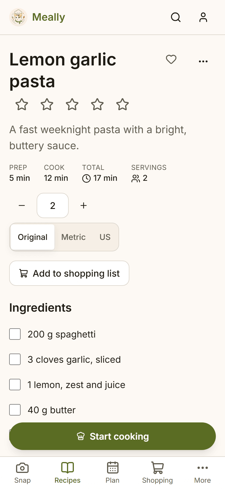
  &nbsp;
  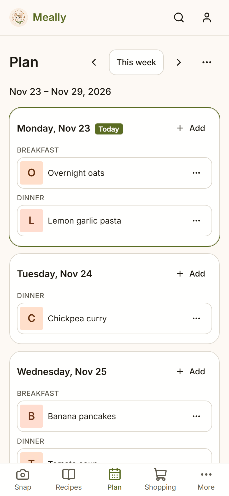
  &nbsp;
  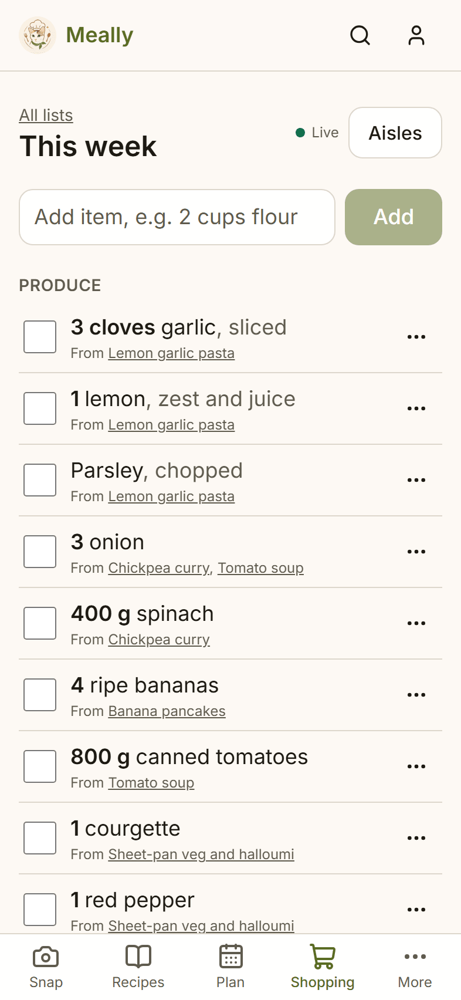
</p>
<sub>Recipe → weekly plan → shopping list, on an iPhone-sized screen.</sub>

</div>

## What is Meally?

Meally keeps your recipes, your weekly meal plan and your shopping list in one place. You import a recipe from any
link, drop it onto a day, and Meally turns the week into a shopping list grouped by aisle. You can also snap a photo
of what you cooked and share it with friends.

It is a clean TypeScript rewrite **inspired by [Mealie](https://github.com/mealie-recipes/mealie)** and
[RecipeSage](https://github.com/julianpoy/RecipeSage). No code is copied from either. It exists for two reasons:

- **A fresher UI.** Light and dark themes, mobile-first layout, cook mode and a command-palette search. Each UI
  decision has a short research note in [`docs/design`](docs/design).
- **Free to host publicly.** Meally is plain **AGPL-3.0** with no "personal use only" clause, so you can run it for
  yourself, your family or a community.

> **Status:** early. Meally is built as a stack of small, reviewable pull requests, so expect rough edges.

## Features

Everything outside the core can be switched off with a [feature flag](docs/design/03-architecture.md#feature-flags)
(flag keys in brackets). [`02-features.md`](docs/design/02-features.md) maps each Mealie and RecipeSage feature to its
place in Meally.

| Area | What you get |
| --- | --- |
| **Recipes** | Library with full-text search, editor with live ingredient parsing, images, favourites and ratings (`ratings`), tags and categories (`organizers`), cookbooks (`cookbooks`), nutrition (`nutrition`) |
| **Importing** | From a URL or bookmarklet (`import-url`), from other apps and files (`import-files`), foods and units (`foods-units`) |
| **Cooking** | Scale servings and convert metric/US (`scaling`), step-by-step cook mode with timers (`cook-mode`), print view (`print`), timeline and comments (`timeline`) |
| **Planning** | Weekly meal plan with suggestion rules and a calendar (iCal) feed (`meal-plan`), shopping lists by aisle with live updates when self-hosted (`shopping-lists`) |
| **Social** | Snap a photo of what you cooked (`snaps`), friends and a feed (`friends`), reactions, push notifications (`push`), public share links (`share-links`) |
| **Running it** | Admin console, export and backups (`backups`), installable offline app (`pwa`), API tokens and [API docs](docs/api.md), webhooks, AI helpers (`ai`, off by default) |

## Quickstart

Build and run the Docker image from source (needs Docker):

```sh
git clone https://github.com/bachtly/Meally.git && cd Meally
docker build -t meally .
docker run -d -p 8080:8080 -v meally-data:/data -e BASE_URL=http://localhost:8080 meally
```

Open <http://localhost:8080>. The first visit shows a setup page that creates the admin account. Docker Compose, an
external Postgres, reverse proxies, every environment variable, backups and upgrades are in
[`docs/self-hosting.md`](docs/self-hosting.md).

<details>
<summary>Run from source without Docker (Node 24)</summary>

```sh
npm install
npm run dev      # API on :8080, web app with hot reload on :5173
npm test
npm run e2e      # Playwright flows (first run: npx playwright install chromium)
```

`npm run seed -w apps/server` adds a demo user (`demo@meally.local` / `demo-password`) with six sample recipes.

</details>

## How it works

The main journey: get a recipe in, plan the week, shop, cook, share.

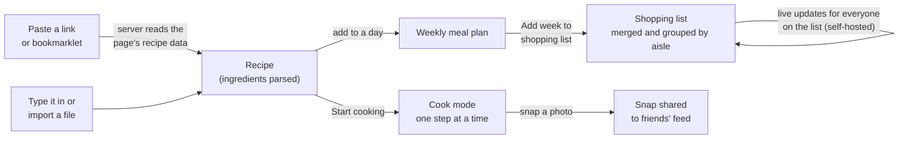

Ingredients are parsed into quantity, unit and food when you save a recipe (shared parser in `packages/shared`). That
is what lets Meally scale servings, convert units and merge "3 onions" from two recipes into one shopping-list line.

## Architecture

One TypeScript codebase, two ways to run it. The same Hono API runs as a Node server in a single Docker container,
or as a Supabase Edge Function behind Cloudflare Pages.

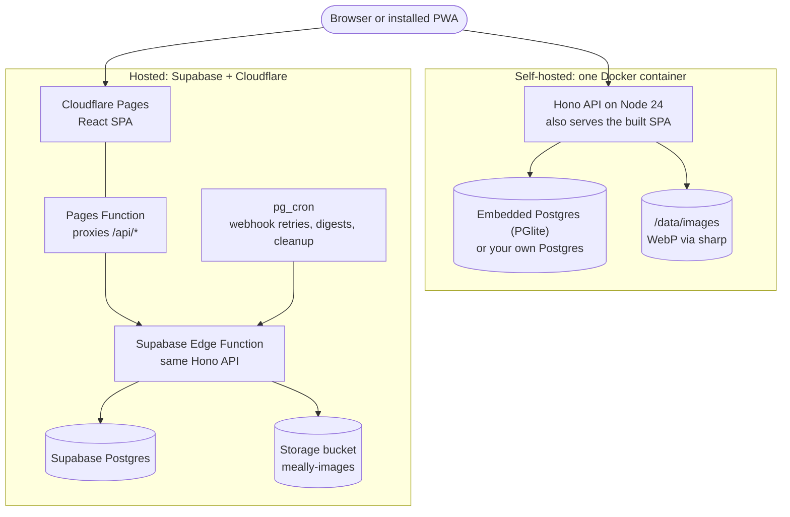

The browser always talks to one origin, so the session cookie stays first-party. For the hosted setup, a GitHub
Actions workflow deploys `main` after CI passes: the Supabase CLI pushes migrations, cron jobs and the function,
and Terraform ([`infra/main.tf`](infra/main.tf)) manages the Pages project, custom domain and DNS record. Details
are in [`docs/deploy.md`](docs/deploy.md).

| Layer | Stack |
| --- | --- |
| Web app (`apps/web`) | React 19, Vite, TypeScript, Tailwind CSS v4, Radix primitives, TanStack Query, React Router |
| API (`apps/server`) | Hono, Drizzle ORM, zod, our own session auth (scrypt, httpOnly cookie), sharp for images |
| Shared (`packages/shared`) | zod schemas and API types, feature-flag registry, ingredient parser, unit conversion |
| Database | Postgres: embedded PGlite by default, any Postgres via `DATABASE_URL`, Supabase when hosted |
| Hosting | Docker (self-host), or Supabase (DB, storage, cron, Edge Function) + Cloudflare Pages, with Terraform for Pages and DNS |
| Testing | Vitest, Testing Library, Playwright end-to-end flows, Storybook with a mocked API |

## Screenshots

<details>
<summary>More screens (light and dark)</summary>

<table>
  <tr>
    <td align="center">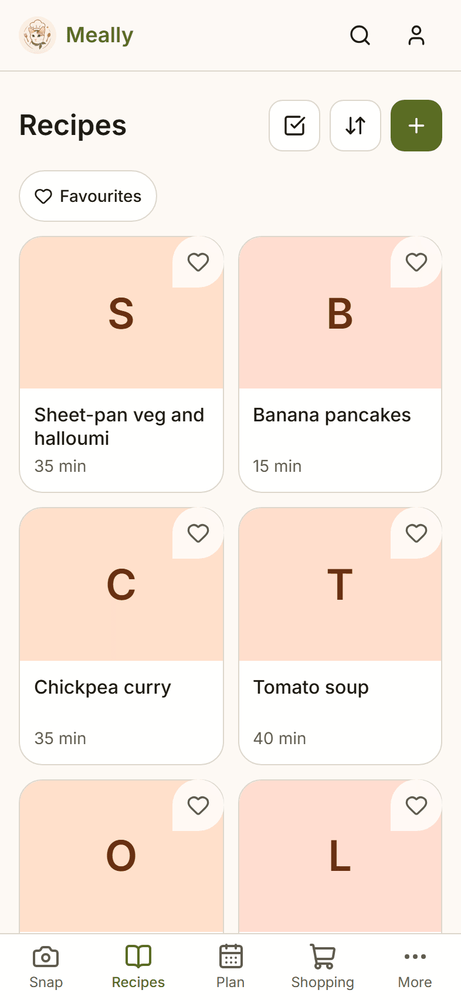<br/><sub>Recipe library</sub></td>
    <td align="center">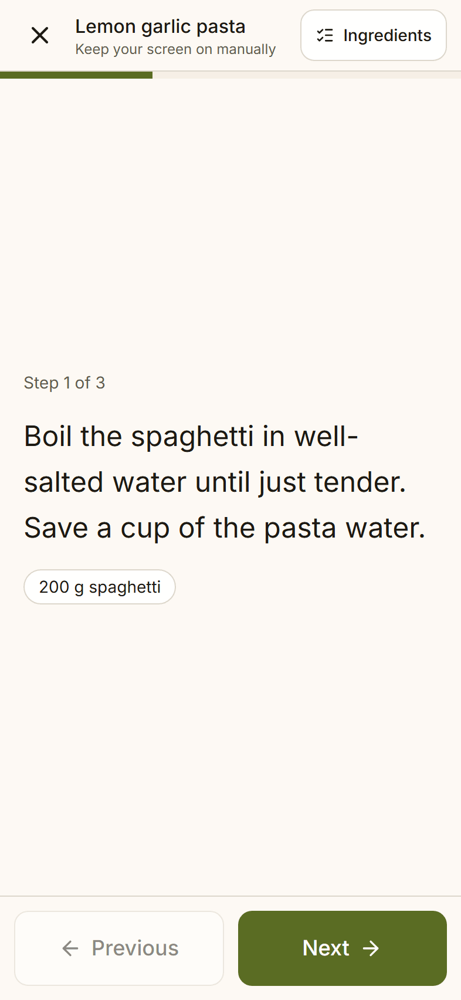<br/><sub>Cook mode</sub></td>
    <td align="center">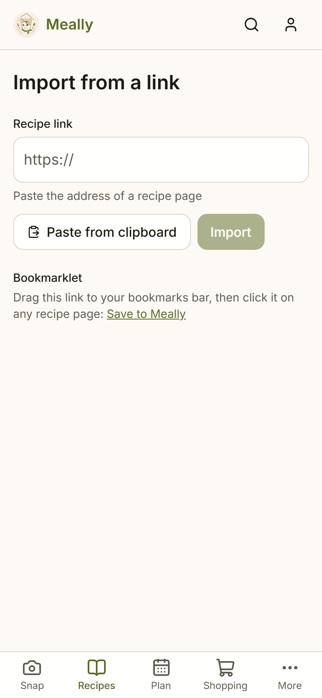<br/><sub>Import from a link or bookmarklet</sub></td>
  </tr>
  <tr>
    <td align="center">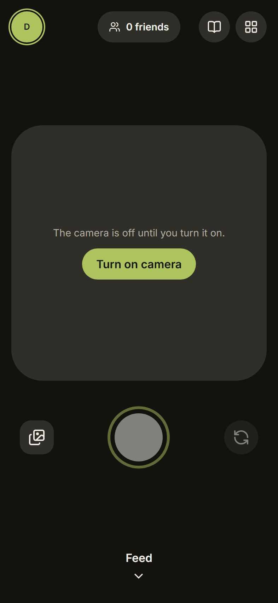<br/><sub>Snap: share what you cooked</sub></td>
    <td align="center">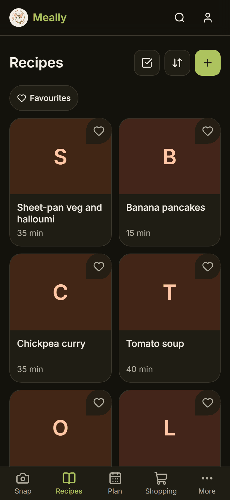<br/><sub>Dark theme: library</sub></td>
    <td align="center">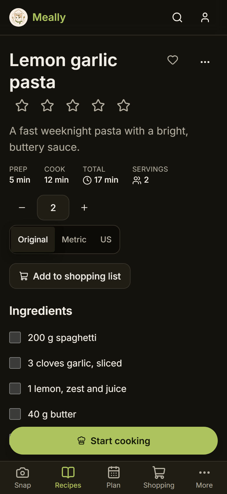<br/><sub>Dark theme: recipe</sub></td>
  </tr>
</table>

Captured with Playwright's iPhone 15 profile (393×852, 2× scale) from a local build with the demo seed data. Meally
is mobile-first; the same screens adapt to a sidebar layout on desktop.

</details>

## Docs

- [Self-hosting](docs/self-hosting.md): Docker, Compose, reverse proxy, environment variables, backups
- [Deploy to Supabase + Cloudflare Pages](docs/deploy.md)
- [API](docs/api.md): REST endpoints and API tokens
- [Architecture](docs/design/03-architecture.md) and the [design notes](docs/design) behind each feature
- [Roadmap](docs/design/roadmap.md)

## Contributing

Issues and pull requests are welcome. Please read [`CLAUDE.md`](CLAUDE.md) first: it covers the conventions (one small
PR per roadmap row, Conventional Commit titles, feature flags, tenant isolation) and the checks to run before you push:

```sh
npm run lint && npm run typecheck && npm test && npm run build
```

## Licence

[AGPL-3.0](LICENSE). Meally is not affiliated with Mealie or RecipeSage.
