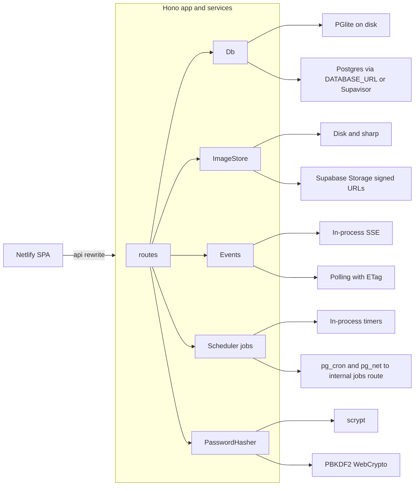

# Design: deploying Meally to Supabase

Status: proposal, 2026-11-11. Docs only. Source marks: a bare link is an official page I read or that a search
returned; **(snippet)** means a search-result summary I did not open; **(judgement)** is my inference.

## 1. Goal and approach

Run Meally on Supabase (Edge Function + Postgres + Storage + Cron) while the self-host Node build keeps working.
One Hono codebase; everything platform-specific sits behind a port (db, storage, events, scheduler, password
hasher) with one adapter per target. Hono has an official
[Supabase Functions guide](https://hono.dev/docs/getting-started/supabase-functions).

## 2. Research findings

### 2.1 Edge Functions limits (Deno runtime)

| Topic | Finding | Source |
|---|---|---|
| CPU time | 2 s of CPU per request, async I/O excluded. A KB article (edited 2026-02) says 200 ms active CPU. The pages conflict; design for the worst case until measured. | [limits](https://supabase.com/docs/guides/functions/limits), [KB](https://supabase.com/kb/troubleshooting/edge-function-cpu-limits) (snippet) |
| Wall clock | 150 s free, 400 s paid; idle timeout 150 s (504 if no response). | [limits](https://supabase.com/docs/guides/functions/limits) |
| Memory | 256 MB. | same |
| Bundle size | 20 MB (CLI bundling), 5 MB (dashboard bundling). | same |
| Request/response body | Not documented anywhere I found. Treat as unknown. | (judgement) |
| npm and Node APIs | `npm:` specifiers and `node:` built-ins work (Deno 2). Native `.node` addons: no source confirms support, so assume not (sharp and native libsql are out). | [dependencies](https://supabase.com/docs/guides/functions/dependencies), [Deno 2](https://supabase.com/docs/guides/functions/deno2) (snippet) |
| `node:crypto` scrypt | Not confirmed by any source. Do not depend on it. | (judgement) |
| Background work | `EdgeRuntime.waitUntil(promise)` keeps the instance alive but does not extend the wall clock. The local CLI ends instances after each request, so background tasks do not finish in `supabase functions serve`. | [background tasks](https://supabase.com/docs/guides/functions/background-tasks.md) |
| URL and prefix | Every request path is prefixed with the function name: `/functions/v1/<name>/...`. Set Hono `basePath` to the function name. | [routing](https://supabase.com/docs/guides/functions/routing.md) |
| HTML | GET responses of `text/html` are rewritten to `text/plain` unless a custom domain is enabled. Functions are not a web host. | [http methods](https://supabase.com/docs/guides/functions/http-methods), [changelog](https://supabase.com/changelog/29633-xhtml-responses-are-only-allowed-with-a-custom-domain-enabled) |
| Streaming/SSE | No official SSE statement. The 150 s idle and 400 s wall limits cap a stream's life, so clients must reconnect. | [limits](https://supabase.com/docs/guides/functions/limits), (judgement) |
| JWT gate | Calls without a Supabase JWT are rejected unless `verify_jwt = false` per function. | [function config](https://supabase.com/docs/guides/functions/function-configuration) |
| Egress | Ports 25 and 587 blocked. | [limits](https://supabase.com/docs/guides/functions/limits) |

### 2.2 Database

- **Drizzle + PGlite** is supported: `drizzle-orm/pglite` plus a Node migrator
  ([Drizzle PGlite](https://orm.drizzle.team/docs/connect-pglite),
  [discussion #2532](https://github.com/drizzle-team/drizzle-orm/discussions/2532) (snippet)).
- **PGlite persistence in Node:** a filesystem backend exists; in-memory is the default and loses data on restart
  ([PGlite filesystems](https://pglite.dev/docs/filesystems)). Maturity is disputed: a third-party directory calls it
  alpha with no durability guarantee (snippet); the maintainers report 10 M weekly downloads
  ([post](https://electric.ax/blog/2026/06/25/pglite-reaches-10-million-weekly-downloads)). Memory is the host
  process's, with no documented limit; I found no measured figure for a household-sized dataset (judgement).
- **Supavisor transaction mode** has no prepared statements: with postgres-js set `prepare: false`
  ([Supabase KB](https://supabase.com/docs/guides/troubleshooting/disabling-prepared-statements-qL8lEL)). Edge
  Functions should use the transaction pooler string, since each invocation may open new connections (judgement).
- **FTS:** FTS5 has no Postgres equivalent. Postgres uses a generated `tsvector` column with a GIN index and
  `websearch_to_tsquery`; ranking differs (`ts_rank` vs bm25), so search tests need re-baselining (judgement).

| | (a) Postgres everywhere | (b) two dialects | (c) SQLite + Turso remote |
|---|---|---|---|
| Schema/migrations | one set; 17 migrations ported once | two sets forever; every PR doubles | unchanged |
| FTS | rewrite once (tsvector) | two implementations | FTS5 kept |
| Supabase fit | native: Supavisor, Cron, Storage | native on one side | foreign vendor; Supabase Postgres unused |
| Self-host | PGlite default (risk above) or any Postgres via `DATABASE_URL` | SQLite as today | needs sqld or a Turso account |
| Cost | highest one-off | highest ongoing | lowest, but misses the goal |

**Recommendation: (a).** Mitigation for the PGlite risk: it is only the default. `DATABASE_URL` to a real Postgres
(docker compose) stays supported, CI runs both, and PR 2 ships a PGlite durability smoke test (kill -9 mid-write,
reopen). If it fails, the self-host default becomes compose Postgres with no design change.

### 2.3 Images
Supabase Storage has private buckets and signed URLs. Image transformations need Pro or above (100 included, then
$5 per 1000) ([docs](https://supabase.com/docs/guides/storage/serving/image-transformations),
[usage](https://supabase.com/docs/guides/platform/manage-your-usage/storage-image-transformations)). `sharp` cannot
run in the function. Options: (1) transformations: paid, not portable; (2) resize in the browser before upload:
free, portable; (3) proxy through the function: burns CPU and memory.
**Recommendation:** an `ImageStore` port (`put`, `get`, `delete`, `url`). Node adapter keeps disk + sharp. Supabase
adapter stores browser-produced 320/800/1600 WebP variants in a private bucket via signed upload URLs (large bodies
never hit the function); `/images/:id/:size` 302s to a short-lived signed URL. The Node server keeps accepting a raw
upload and resizing with sharp, so the API works for both.

### 2.4 Scheduled work
Supabase Cron is pg_cron + pg_net calling a function URL, with the token in Vault
([docs](https://supabase.com/docs/guides/functions/schedule-functions.md)). pg_net is fire-and-forget and schedules
run in UTC (both snippet). `waitUntil` only extends one request and is capped by wall clock, so it is not a scheduler.
**Recommendation:** a `Scheduler` port with job handlers `webhook-retry`, `daily-digest`, `import-jobs`.
Node adapter keeps in-process timers. Supabase adapter exposes `POST /internal/jobs/:name` guarded by a shared secret
(`verify_jwt = false`), called by pg_cron every minute (retries, imports) and hourly (digest, sent to households whose
local hour matches, because cron is UTC). Handlers are idempotent and claim rows with `FOR UPDATE SKIP LOCKED`.
Imports: the request enqueues a row; the next tick (or a `waitUntil` kick for latency) processes a bounded slice.

### 2.5 Live shopping list
SSE on an edge function is bounded by idle/wall clock and holds a worker per viewer (judgement). Supabase favours
Broadcast over `postgres_changes`, which checks RLS per subscriber on one thread
([migrate guide](https://supabase.com/docs/guides/realtime/migrate-from-postgres-changes),
[benchmarks](https://supabase.com/docs/guides/realtime/benchmarks)). Private Realtime channels use RLS on
`realtime.messages`, which needs Supabase-issued JWTs and so couples us to Supabase Auth (judgement). Polling needs
nothing. **Recommendation:** an `Events` port (`publish`, `subscribe`); the web `useLiveList` hook already refetches
on events. Node adapter: current SSE. Supabase adapter: client polls `GET /lists/:id` every 5 s while the tab is
visible, using ETag/304, backing off when hidden. A Broadcast adapter (public channel, unguessable id, payload only
"changed") can come later without touching callers.

### 2.6 Auth
Keep our own sessions so both targets behave identically; Supabase Auth would force a user bridge and change CSRF
and API-token behaviour. The risk is hashing cost: scrypt N=2^17 needs 128 MB and heavy CPU against a 256 MB
and 2 s (or 200 ms) budget, and `node:crypto` scrypt is unconfirmed on Deno. OWASP lists Argon2id, then scrypt
(N=2^17, r=8, p=1), and PBKDF2-HMAC-SHA256 at 600 000 iterations (sources also quote 310 000)
([OWASP](https://cheatsheetseries.owasp.org/cheatsheets/Password_Storage_Cheat_Sheet.html) (snippet)).
**Recommendation:** a `PasswordHasher` port with self-describing hashes (`scrypt$...`, `pbkdf2-sha256$iter$...`).
Both targets verify both formats. Edge default is PBKDF2 via WebCrypto (native, fast); Node default stays scrypt.
Cost parameters become env-configurable. A successful login rehashes to the target default. Measure PBKDF2 at 600k on
a deployed function in PR 3 before fixing the number.

### 2.7 Web hosting and cookies
Functions cannot serve the SPA (HTML rewrite above). External proxying by host:
- Cloudflare Pages: `_redirects` proxying supports relative URLs only, not external domains
  ([docs](https://developers.cloudflare.com/pages/configuration/redirects/)); needs a Pages Function.
- Netlify: a `200` redirect to an external URL is a proxy
  ([docs](https://docs.netlify.com/manage/routing/redirects/rewrites-proxies)).
- Vercel: external `rewrites` in `vercel.json` ([docs](https://vercel.com/docs/routing/rewrites)).

**Recommendation: Netlify** (Vercel is equivalent), serving `apps/web/dist` and rewriting `/api/*` to
`https://<ref>.supabase.co/functions/v1/meally/api/*` with status 200. The browser sees one origin, so cookies stay
`SameSite=Lax; HttpOnly`, no CORS is needed, and Origin/X-Requested-With CSRF keeps working. CSRF must compare Origin
to a configured `MEALLY_PUBLIC_URL`, not to Host, since the proxy changes Host (judgement). Fallback if proxying
misbehaves: a Supabase custom domain `api.example.com` under the same registrable domain, cookie `Domain=example.com`,
CORS allow-list of one origin with credentials, `X-Requested-With` kept as the preflight trigger. Different-eTLD+1
cross-site is not supported. `/api` stays network-only in the service worker; `/s/:token` is an SPA route.

### 2.8 Features that do not fit
- Backups and the restore CLI are Node-only; Supabase has its own DB backups. Forced off: `backups` (admin backups).
  Per-user recipe export stays on but must stay within 256 MB (judgement).
- Local-disk paths (`dataDir`, sqlite file, image dir) are unused; `DATABASE_URL` and `ImageStore` replace them.
- In-process timers, the import queue and SSE are replaced by the ports above.
- `MEALLY_ALLOW_PRIVATE_URLS` stays off by default. A `platform` setting (`node | supabase`) drives defaults; the
  admin features page shows forced-off flags as locked.

### 2.9 Deploy workflow
```
supabase/
  config.toml                  # [functions.meally] verify_jwt=false, entrypoint
  functions/meally/index.ts    # Deno.serve(app.fetch), Hono basePath('/meally')
  migrations/                  # SQL generated by drizzle-kit, applied by `supabase db push`
  seed.sql                     # cron schedules and Vault secret refs, no app data
```
Migrations: drizzle-kit stays the author; Supabase applies the same SQL with `supabase db push`; the app's own
migrator runs only on PGlite/compose. Secrets: `supabase secrets set --env-file` for `DATABASE_URL` (pooler),
`MEALLY_PUBLIC_URL`, `CRON_SECRET`, `STORAGE_*`. GitHub Action on push to main: `supabase/setup-cli`,
`supabase link`, `db push`, `functions deploy meally`; Netlify deploys the SPA itself
([Actions guide](https://supabase.com/docs/guides/functions/examples/github-actions.md),
[deploy](https://supabase.com/docs/guides/functions/deploy.md)). Bundle the server with esbuild into one ESM file
under 20 MB.

## 3. Decisions

- D1 Postgres everywhere via Drizzle pg-core; Supabase via `DATABASE_URL`; PGlite self-host default, compose Postgres as fallback. Evidence: Drizzle PGlite driver; two dialects double every PR; Turso leaves Supabase Postgres unused.
- D2 FTS becomes generated `tsvector` + GIN with `websearch_to_tsquery`; search tests re-baselined. Evidence: FTS5 does not exist in Postgres.
- D3 postgres-js with `prepare: false` through the Supavisor transaction pooler. Evidence: [Supabase KB](https://supabase.com/docs/guides/troubleshooting/disabling-prepared-statements-qL8lEL).
- D4 `ImageStore` port; browser resize + private bucket + signed URLs on Supabase; sharp stays on Node. Evidence: native addons unconfirmed; transformations Pro-only.
- D5 `Scheduler` port; pg_cron + pg_net calls `/internal/jobs/:name` with a shared secret; idempotent handlers. Evidence: [schedule docs](https://supabase.com/docs/guides/functions/schedule-functions.md); `waitUntil` does not extend wall clock.
- D6 `Events` port; Supabase adapter polls with ETag; Broadcast is a later optional adapter. Evidence: idle/wall limits; own auth rules out private channels.
- D7 Keep own sessions; `PasswordHasher` port, versioned hashes, PBKDF2-SHA256 on edge, scrypt on Node, rehash on login. Evidence: 128 MB scrypt vs 256 MB / 2 s limit; OWASP lists PBKDF2.
- D8 SPA on Netlify with a 200 rewrite of `/api/*` to the function. Evidence: Netlify and Vercel proxy externally, Cloudflare `_redirects` does not; functions cannot serve HTML.
- D9 CSRF compares Origin with `MEALLY_PUBLIC_URL`, not Host. Evidence: the proxy changes Host (judgement).
- D10 On Supabase, force off `backups` and ship no restore CLI; keep per-user export. Evidence: Supabase manages DB backups; no local disk.
- D11 drizzle-kit authors migrations; `supabase db push` applies them; GitHub Action uses `setup-cli`. Evidence: [Actions guide](https://supabase.com/docs/guides/functions/examples/github-actions.md).
- D12 One function `meally`, Hono `basePath('/meally')`, `verify_jwt = false`. Evidence: [routing](https://supabase.com/docs/guides/functions/routing.md).

## 4. Ports and adapters



## 5. PR plan (stacked, in order)

1. **Ports, no behaviour change.** `ImageStore`, `Events`, `Scheduler`, `PasswordHasher` interfaces with Node adapters wrapping current code; `platform` config. Files: `apps/server/src/ports/*`, `features/recipes/service.ts`, `features/shopping/*` (SSE), `features/backups`, `features/auth/password.ts`, `lib/config.ts`. Verify: lint/typecheck/test/build; existing tests unchanged.
2. **Postgres schema and FTS.** pg-core schema, regenerated migrations, tsvector search, PGlite default, `DATABASE_URL`, CI matrix (PGlite + Postgres service), SQLite-to-Postgres export/import script. Files: `apps/server/src/db/**`, `drizzle.config.ts`, `.github/workflows/ci.yml`, search tests. Verify: whole suite on both backends; PGlite kill-and-reopen smoke test.
3. **Edge-compatible hasher and entry.** PBKDF2 hasher, versioned hashes, rehash on login; `entry-edge.ts` using `app.fetch` with no Node-only imports; esbuild bundle. Files: `features/auth/*`, `apps/server/src/entry-edge.ts`, bundler config, import-boundary lint rule. Verify: unit tests for both hash formats; bundle-size check; `supabase functions serve` answers the health route; PBKDF2 timing recorded on a deployed function.
4. **Supabase adapters.** `SupabaseImageStore`, `/internal/jobs/:name` with secret, idempotent handlers, polling `Events`, browser resize + signed upload in the web app. Files: `apps/server/src/adapters/supabase/*`, `features/*/jobs.ts`, `apps/web/src/features/recipes/upload.ts`, `features/shopping`. Verify: unit tests with fakes; tenant-isolation test for signed URLs; job re-entrancy test.
5. **`supabase/` folder, config and CI.** `config.toml`, function entry, `seed.sql` (cron + Vault), `netlify.toml` rewrite, deploy workflow, forced flags for `platform=supabase`. Files: `supabase/**`, `netlify.toml`, `.github/workflows/deploy-supabase.yml`, shared `features.ts`. Verify: deploy to a throwaway project; login cookie round-trips through the rewrite; foreign Origin rejected; a cron tick runs a webhook retry.
6. **Docs.** Self-host vs Supabase guide; measured limits replace the conflicting figures; update `03-architecture.md`. Verify: follow the guide on a clean project.

## 6. Open questions

1. Is the CPU limit 2 s or 200 ms today? Measure PBKDF2 and cold start on a real project before PR 3 fixes the cost.
2. Does `node:crypto` scrypt run on the Edge runtime? Unverified; D7 avoids needing it.
3. Edge request/response body limits are undocumented; the upload path avoids them but needs a test.
4. PGlite durability and memory at our dataset size; should compose Postgres be the default instead?
5. Does Netlify forward `Origin` and `Set-Cookie` unchanged through the external rewrite? A PostHog guide hints the default `.netlify.app` domain can misbehave (snippet); test with a custom domain.
6. Migrate existing SQLite installs automatically, or document export/import only?
7. Declare Pro as the supported tier (400 s wall clock, transformations unneeded)?
8. Does 5 s polling per open list fit the free invocation quota?
