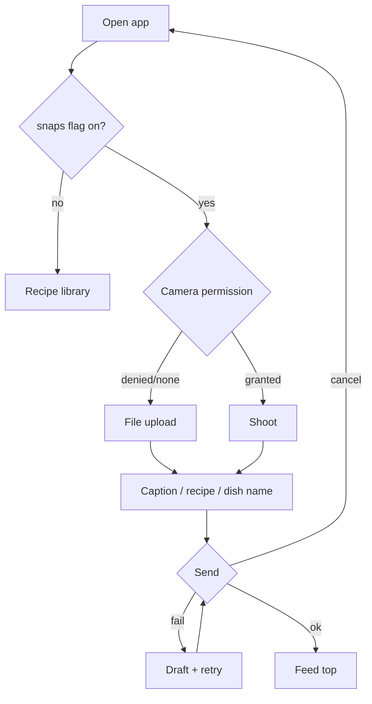
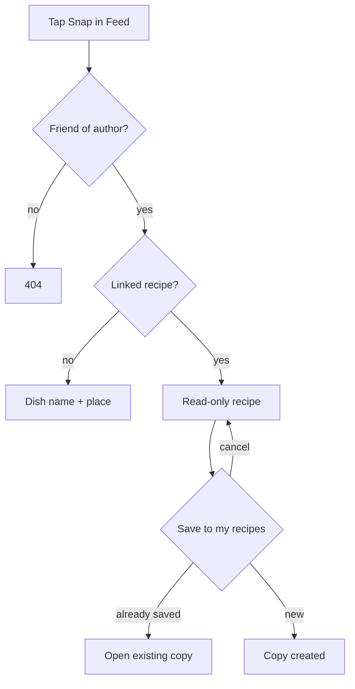
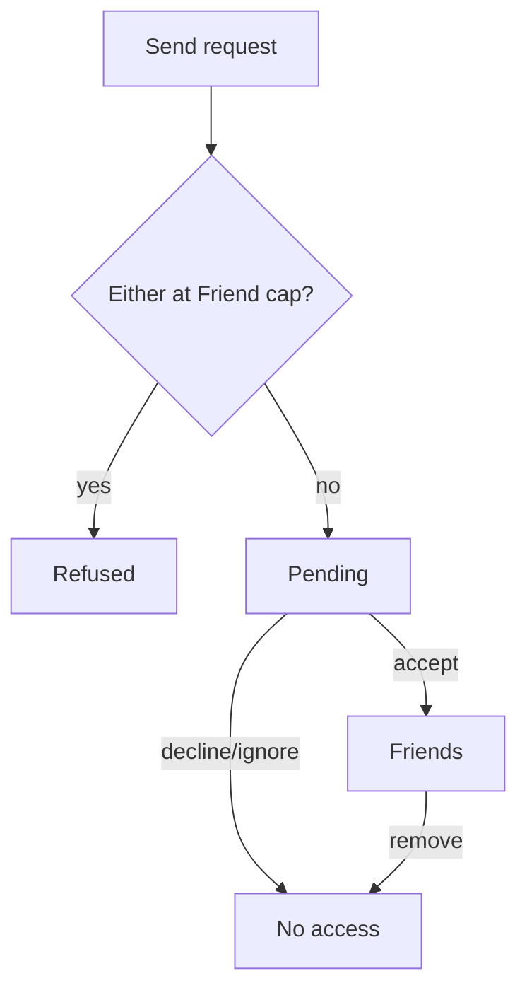
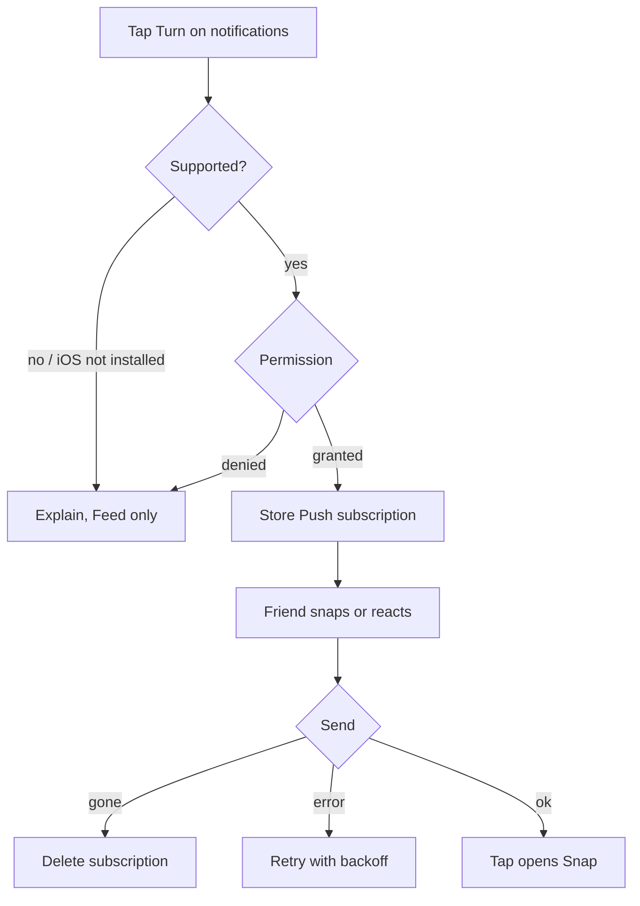
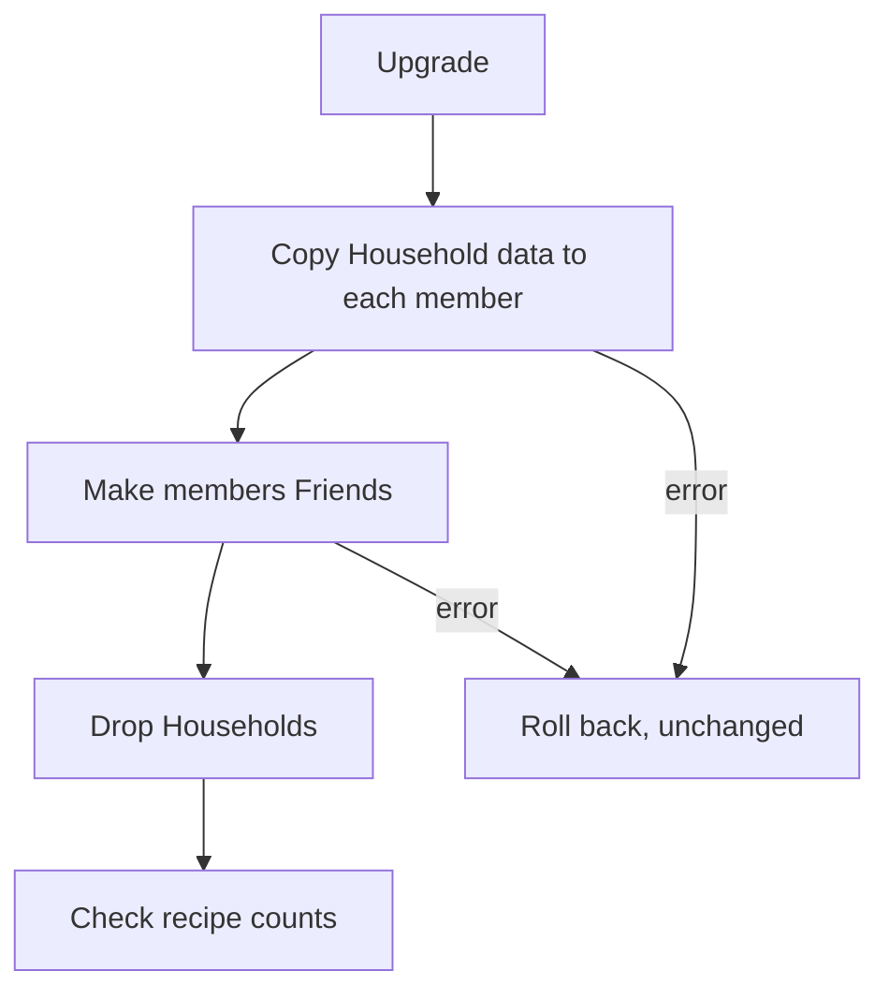

# Snap loop: requirements

Inputs: [brief](00-brief.md), [research](01-research.md), [ADR 0001](adr/0001-replace-households-with-user-ownership-and-friendships.md),
[ADR 0002](adr/0002-scope-queries-by-user-or-accepted-friendship.md). Direction: O1 (full replacement of Households).
Terms follow the brief's Glossary.

## Actors
| Actor | Description | Permissions |
|---|---|---|
| User | A signed-in person | Full access to own recipes, plans, lists, Snaps, Push subscriptions |
| Friend | Another User with an accepted Friendship | Reads the User's Snaps and their Linked recipes, read-only; adds a Reaction ([ADR 0002](adr/0002-scope-queries-by-user-or-accepted-friendship.md)) |
| Non-friend | Any other User or anonymous visitor | No access to the User's data; gets 404 |
| Instance admin | Runs the self-hosted instance | Sets the Friend cap and VAPID keys |
| Migration | One-off job that retires Households | Rewrites ownership from Household to User |

## Use cases
### UC-1 · Take and send a Snap
User · opens the app · signed in, `snaps` flag on.
Main flow: 1. Home shows the camera. 2. User shoots. 3. User optionally adds a caption, Linked recipe or dish name and place. 4. User sends. 5. The Snap appears at the top of the Feed for the User and their Friends.
Exception flows: 1a. Camera permission denied or unavailable → file upload picker. 4a. Upload fails → Snap kept as a local draft with retry. 4b. Image rejected (type or size) → error, no Snap created.
Postconditions: one Snap owned by the User, photo stored through the Image pipeline.

### UC-2 · Open a Friend's Snap and save the recipe
User · taps a Snap in the Feed · Snap author is a Friend.
Main flow: 1. Linked recipe opens read-only. 2. User taps "Save to my recipes". 3. A copy with an "adapted from" reference is created.
Exception flows: 1a. No Linked recipe (Eat-out snap) → dish name and place shown, no recipe. 1b. Friendship ended or recipe deleted → 404 view. 3a. User already saved it → open the existing copy (dedupe by origin, `apps/server/src/features/share/save.ts:26-31`).
Postconditions: the User owns an independent copy.

### UC-3 · Link an Eat-out snap to a recipe later
User · opens own Eat-out snap · Snap has a dish name and no Linked recipe.
Main flow: 1. User picks "Link a recipe" or "Find a recipe". 2. Search runs on the dish name over own recipes. 3. User picks one; Snap gets the Linked recipe.
Exception flows: 2a. No results → empty state with "New recipe" prefilled with the dish name. 1a. Not the author → action hidden; API returns 404.

### UC-4 · Make and manage Friends
User · sends an invite · `friends` flag on.
Main flow: 1. User sends a Friendship request. 2. The other User accepts. 3. Both see each other's Snaps.
Exception flows: 1a. Either side is at the Friend cap → request refused with a message. 2a. Declined or ignored → stays pending, no access. 3a. Either User removes the Friendship → access ends at once.

### UC-5 · Receive push for new Snaps and Reactions
User · taps "Turn on notifications" · `push` flag on, browser supports Web Push.
Main flow: 1. Browser asks for permission. 2. A Push subscription is stored. 3. On a Friend's new Snap or a Reaction to the User's Snap, a push is sent. 4. Tapping it opens the Snap.
Exception flows: 1a. Permission denied → Feed still works, prompt not shown again automatically. 1b. iOS not installed to Home Screen → explain install, no prompt. 3a. Endpoint gone → subscription deleted. 3b. Send fails → retry with backoff.

### UC-6 · Migrate Households to Users
Migration · server upgrade · existing Households.
Main flow: 1. Each member receives a full copy of the Household's recipes, plans, lists and images. 2. Members of the same Household become Friends. 3. Households are dropped.
Exception flows: 1a. Slug collision in a User's recipes → slug made unique. 1b. Recipe with null `created_by` → copied to every member. 1c. Any step fails → whole migration rolls back, data unchanged.
Postconditions: recipe count per User ≥ recipe count of their former Household.

## User stories
### US-1 · As a User, I want to snap food from the home screen, so that sharing is fast (G1)
- AC-1.1 When a signed-in User opens `/` with `snaps` on, the web app shall show the camera as the home screen.
- AC-1.2 When the camera is open, the web app shall let the User shoot, optionally caption and send in at most 3 taps.
- AC-1.3 If camera permission is denied or no camera exists, then the web app shall offer a file upload instead.
- AC-1.4 If the upload fails, then the web app shall keep the Snap as a draft and offer retry.

### US-2 · As a User, I want to open a Friend's Linked recipe and keep a copy, so that I can cook it (G2)
- AC-2.1 When the User taps a Friend's Snap with a Linked recipe, the web app shall open that recipe read-only.
- AC-2.2 When the User taps "Save to my recipes", the server shall create a copy owned by the User, with its images and an "adapted from" reference; if a copy from the same origin exists, it shall return that copy.
- AC-2.3 If the requester is not a Friend of the author, then the server shall return 404 for the Snap and its Linked recipe.
- AC-2.4 The server shall expose Friend read access only on the Snap, Feed and Linked recipe read paths; every other query shall filter by the session User's id.

### US-3 · As a User, I want an Eat-out snap to keep the dish and place, so that I can find the recipe later (G3)
- AC-3.1 When the User sends a Snap without a Linked recipe, the server shall accept a dish name and an optional place.
- AC-3.2 When the author links a recipe to an Eat-out snap, the server shall set the Linked recipe; for anyone else it shall return 404.
- AC-3.3 When the author taps "Find a recipe", the web app shall search the author's recipes by dish name, and show an empty state with a prefilled "New recipe" action if nothing matches.
- AC-3.4 The web app shall store a place only as text the User enters. TBD: is device geolocation in scope, and at what precision?

### US-4 · As a User, I want a full-screen Feed and opt-in push, so that I see Friends' Snaps (G4)
- AC-4.1 When the User opens the Feed, the web app shall show own and Friends' Snaps newest first, full screen, with loading, empty and error states.
- AC-4.2 When the User adds a Reaction, the server shall store it and notify the author, and the web app shall show no counts.
- AC-4.3 When the User taps "Turn on notifications", the web app shall request push permission and store a Push subscription; it shall never request permission without a user gesture.
- AC-4.4 When a Friend sends a Snap or reacts to the User's Snap, the server shall send a push to each of the User's Push subscriptions with a payload of at most 2 KB.
- AC-4.5 If the push service reports a subscription gone, then the server shall delete it; on other failures it shall retry with backoff.
- AC-4.6 If push is denied or unsupported, then the web app shall keep the Feed working and explain how to enable push (Home Screen install on iOS).

### US-5 · As a User, I want my recipe tools to keep working, so that the app stays useful (G5)
- AC-5.1 The web app shall keep the library, editor, cook mode, meal plan and shopping reachable from the nav, scoped to the session User.

### US-6 · As a User, I want Friendships instead of a Household, without losing data, so that I share with the people I choose (G6)
- AC-6.1 When a User sends a Friendship request and the other accepts, the server shall create an accepted Friendship visible to both.
- AC-6.2 If either User is at the Friend cap (instance setting, default 20), then the server shall refuse the request or acceptance with a clear error.
- AC-6.3 When either User removes a Friendship, the server shall end Friend access at once (next request returns 404).
- AC-6.4 When the Migration runs, the server shall rekey every household-owned row to the Household's single User and drop Households. If any Household has more than one member, it aborts without changes. *(Amended by [ADR 0003](adr/0003-migrate-single-member-households-by-rekeying.md). The earlier "full copy for each member, members become Friends" wording is superseded.)*
- AC-6.5 If any Migration step fails, then the server shall roll back and leave existing data unchanged.

## User flows

## Non-functional requirements
| Id | Quality | Scenario | Target |
|---|---|---|---|
| NFR-1 | usability | Send a Snap after the camera opens | at most 3 taps (brief G1) |
| NFR-2 | data volume | Friends per User | Friend cap, instance setting, default 20 (research decisions) |
| NFR-3 | payload | Push payload size | at most 2 KB (Safari limit, [r2q01-01]) |
| NFR-4 | integrity | Migration | 0 recipes lost: per User ≥ former Household count (brief G6) |
| NFR-5 | accessibility | All new screens | WCAG AA contrast, touch targets at least 44 px, widths 360-1440 px (CLAUDE.md) |
| NFR-6 | security | Non-friend reads a Snap, Feed item or Linked recipe | 404 in 100% of cases, one test per read path ([ADR 0002](adr/0002-scope-queries-by-user-or-accepted-friendship.md)) |
| NFR-7 | latency | Friend's Snap reaches the Feed or a push | TBD: target delivery time? |
| NFR-8 | retention | Snaps and their photos | TBD: kept forever, or expire? |
| NFR-9 | data volume | Max Snap image upload size | TBD: reuse the existing Image pipeline limit? |

## Out of scope
- Brief non-goals: native app, widgets, public profiles, discovery, counts, AI recognition, Rollcall, streaks, paid tiers.
- Shared editing of plans and lists between Friends (no edit level), pending [#76](https://github.com/bachtly/Meally/issues/76).
- Migrating existing Timeline events into Snaps; the Feed starts empty (research decisions).
- Block and report controls. TBD: needed in the first release?
- Video snaps.

## Decisions (owner, 2026-11-12)
- Friendship requests go through a one-time invite link, the same pattern as today's household invites. Nobody can use
  it to check whether an account exists.
- Snaps are kept until their author deletes them (this answers NFR-8).
- The place on an Eat-out snap is typed text only, with no location permission (this answers AC-3.4).

## Open questions
Approved as is, over a REVISE verdict from the critic. The later stages must resolve these findings:
- **Blocking: migration scope.** AC-6.4 and NFR-4 cover only recipes, plans, lists and images. Each household-owned
  table needs a rule: copy to each member, assign to one member, or delete. The tables are invites, cookbooks, foods,
  import_jobs, the three meal-plan tables, organizers and tags, share_links, aisle labels, timeline_events, tokens and
  webhooks. NFR-4 should check row counts per table. The data-model stage owns the per-table mapping.
- **Blocking: Linked recipe ownership.** The server must reject a Snap whose Linked recipe isn't owned by the session
  User (404). The friend read path must check the Linked recipe's owner, not only the Snap's author.
- ADR 0002 asks for two 404 tests on each friend-readable path: a non-friend, and a pending Friendship. AC-2.3 and
  NFR-6 cover only the non-friend.
- Migration safety: take a backup and offer a dry run before the migration (ADR 0001). Don't remove original image
  files until the database commit succeeds, and clean up files copied by a failed run.
- Friend cap during migration: a household with more than 20 members needs a rule. The lead's proposal is that the
  migration ignores the cap, and users over the cap can remove Friends but not add new ones.
- Retrying a draft must create at most one Snap, for example through a client-generated id the server dedupes.
- Reactions: one per User per Snap per emoji, with a single notification. Push retries need a maximum count, as
  webhooks have.
- NFR-7 (delivery latency) has no number. The lead proposes p95 under 60 s. NFR-9: reuse the 10 MB limit
  (`MAX_IMAGE_BYTES`, `apps/server/src/features/recipes/image-input.ts:7`).
- UC-3 has no flow diagram. The `friends` and `push` flags have no flag-off path (routes return 404 and the UI is
  hidden).
- Shared editing (#76) and block or report stay out of scope for now.
- Terms: "invite" in UC-4 should be "Friendship request". "Draft", "Migration" and "Instance admin" aren't in the
  glossary.
