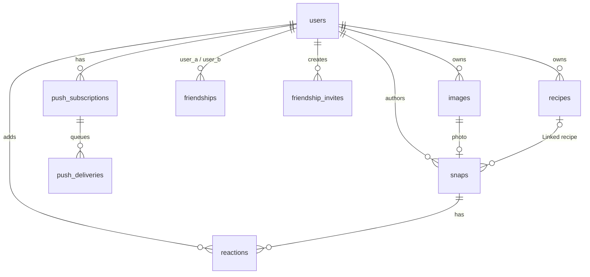

# Snap loop: data model

Inputs: [brief](00-brief.md), [research](01-research.md), [requirements](02-requirements.md),
[ADR 0001](adr/0001-replace-households-with-user-ownership-and-friendships.md),
[ADR 0002](adr/0002-scope-queries-by-user-or-accepted-friendship.md). Terms follow the brief's Glossary.
Conventions kept from `apps/server/src/db/schema/`: `text` ids, snake_case columns, `timestamp with time zone`
for `*_at` (`auth.ts:1-21`), one-time tokens stored as a sha256 `token_hash` (`auth.ts:23-31`), settings in
`instance_settings` (`auth.ts:59-62`).

## Entities
| Entity | Purpose | Owning module | New / changed | Lifecycle (created → … → deleted) |
|---|---|---|---|---|
| `snaps` (PK `id`) | One Snap | snaps | new | sent → (Linked recipe set or cleared) → deleted by author or with the user |
| `reactions` (PK `snap_id, user_id, emoji`) | One Reaction | snaps | new | added → removed by reactor, or with the Snap or user |
| `friendships` (PK `user_a_id, user_b_id`) | Symmetric Friendship | friends | new | pending → accepted → deleted (removed, declined, or a user deleted) |
| `friendship_invites` (PK `id`) | One-time Friendship request link | friends | new | created → used or expired → deleted |
| `push_subscriptions` (PK `id`) | One Push subscription | push | new | stored → endpoint gone or user turns off → deleted |
| `push_deliveries` (PK `id`) | Pending push sends with retry, like `webhook_deliveries` (`webhooks.ts:28-42`) | push | new | queued → sent or given up → pruned (TBD: when?) |
| `users` | Drops `household_id`, `household_role` | auth | changed | unchanged |
| `households` | Retired | auth | dropped | removed by the Migration |
| 15 household-scoped tables (see Migration) | `household_id` becomes `user_id` | each feature | changed | unchanged |
| `images` | Snap photo; files move to `$DATA_DIR/images/<userId>/` (`recipes.ts:6`) | recipes | changed | unchanged |

## ERD

## Attributes (new or changed only)
| Entity.field | Type | Null | Default | Constraint / note |
|---|---|---|---|---|
| snaps.user_id | text | no | | FK users, cascade |
| snaps.image_id | text | no | | FK images, cascade; image owned by `user_id` |
| snaps.client_id | text | no | | Unique `(user_id, client_id)`; dedupes draft retries (requirements open questions) |
| snaps.caption | text | yes | | TBD: max length? |
| snaps.dish_name | text | yes | | Eat-out snap; TBD: max length? |
| snaps.place | text | yes | | Typed text only, no coordinates (requirements decisions) |
| snaps.recipe_id | text | yes | | Linked recipe; FK recipes, set null on delete |
| snaps.created_at | timestamptz | no | | Feed order |
| reactions.emoji | text | no | | TBD: free emoji or a fixed set? |
| reactions.created_at | timestamptz | no | | Never aggregated (brief non-goals) |
| friendships.user_a_id, user_b_id | text | no | | FK users, cascade; check `user_a_id < user_b_id` |
| friendships.status | text enum `pending`, `accepted` | no | `pending` | |
| friendships.requested_by | text | no | | One of the pair |
| friendships.created_at, accepted_at | timestamptz | no / yes | | |
| friendship_invites.token_hash | text | no | | Unique; sha256, like `invites` (`auth.ts:23`) |
| friendship_invites.created_by | text | no | | FK users, cascade |
| friendship_invites.expires_at, used_at | timestamptz | no / yes | | TBD: expiry length (household invites' value to be reused?) |
| push_subscriptions.user_id | text | no | | FK users, cascade |
| push_subscriptions.endpoint | text | no | | Unique (one row per browser) |
| push_subscriptions.p256dh, auth | text | no | | Web Push keys |
| push_subscriptions.created_at | timestamptz | no | | |
| push_deliveries.subscription_id | text | no | | FK push_subscriptions, cascade |
| push_deliveries.payload | jsonb | no | | ≤ 2 KB (NFR-3) |
| push_deliveries.attempts, next_attempt_at | integer, timestamptz | no | 0, now | TBD: max attempts (webhooks pattern, `webhooks/service.ts:17-23`) |
| `<table>`.user_id | text | no | | Replaces `household_id` on the 15 tables; FK users, cascade |
| recipes unique | | | | `(user_id, slug)` replaces `recipes_household_slug_uq` (`recipes.ts:44`); same for cookbooks, organizers, custom units |
| instance_settings `friend_cap` | text | | `20` | Friend cap (brief Glossary) |
| users.household_id, household_role | | | | Dropped (`auth.ts:15-19`) |

## Invariants
| Rule | Enforced where |
|---|---|
| A Snap's Linked recipe is owned by the Snap's author; else 404 on write | domain (service checks `recipes.user_id = session user`) plus test; friend read path re-checks the recipe owner |
| A Snap's image is owned by its author | domain |
| One row per pair: `user_a_id < user_b_id`, PK on the pair | DB check and PK |
| No self-Friendship | DB check (`<` implies it) |
| Accepted Friendships per user ≤ Friend cap, on request and on accept | domain, in the accept transaction; not enforced by the Migration (TBD, see open questions) |
| Friend read access only on Snap, Feed and Linked recipe paths, only for `accepted` | domain ([ADR 0002](adr/0002-scope-queries-by-user-or-accepted-friendship.md)); two 404 tests per path (non-friend, pending) |
| One Reaction per user per Snap per emoji, one notification | DB PK; domain sends push only on insert |
| One Snap per `(user_id, client_id)` | DB unique |
| Every other query filters by session `user_id` | domain plus per-table 404 test (CLAUDE.md rule, rewritten per ADR 0002) |
| Recipe slugs unique per user | DB unique |
| Push payload ≤ 2 KB | domain |

## Access patterns
| Query or write (UC/AC id) | Frequency | Index or key | Expected volume and growth |
|---|---|---|---|
| Feed: own and Friends' Snaps newest first (AC-4.1) | each app open | `snaps (user_id, created_at desc)`; friend ids from `friendships` | ≤ 21 authors per Feed (Friend cap 20); TBD: Snaps per user per day? |
| Friend check for one author (AC-2.3) | every friend read | PK on ordered pair | 1 row |
| List my Friendships, pending and accepted (UC-4) | per friends view | PK leads with `user_a_id`; index `(user_b_id)` | ≤ cap accepted, pending unbounded (TBD) |
| Count accepted for cap (AC-6.2) | per request and accept | same as above | ≤ 20 |
| Send Snap, dedupe retry (UC-1) | per Snap | unique `(user_id, client_id)` | grows forever (Snaps kept until deleted) |
| Snaps of a recipe, set null on delete (UC-3) | per recipe delete | index `snaps (recipe_id)` | small |
| Reactions of a Snap (AC-4.2) | per Snap view | PK leads with `snap_id` | few per Snap |
| Redeem invite (UC-4) | rare | unique `token_hash` | small |
| Subscriptions of a user (AC-4.4) | per push | index `push_subscriptions (user_id)` | few per user |
| Delete gone endpoint (AC-4.5) | on 404/410 | unique `endpoint` | |
| Due deliveries (AC-4.5) | worker poll | index `push_deliveries (next_attempt_at)` | bounded by pruning |
| Save to my recipes dedupe (AC-2.2) | per save | `recipes (user_id, origin_recipe_id)` replaces `recipes_household_origin_idx` (`recipes.ts:46`) | |
| All recipe tools (AC-5.1) | as today | existing household indexes re-keyed to `user_id` | unchanged |

## Transactions and consistency
- Send Snap: image row plus Snap in one transaction; the file is written first and removed if the transaction fails.
- Accept Friendship: lock both users' Friendships, check the cap, set `accepted` in one transaction.
- Reaction insert and push enqueue in one transaction; delivery runs after commit.
- Cascades: deleting a user deletes their Snaps, Reactions, Friendships, invites and Push subscriptions; deleting a
  Snap deletes its Reactions and its image (TBD: images are shared by recipes today; delete only if unreferenced?);
  deleting a recipe sets `snaps.recipe_id` null (the Snap becomes Eat-out-like, no dish name); deleting a Friendship
  ends access at once because every friend read joins `friendships`.
- Save to my recipes copies the recipe and images in one transaction (`share/save.ts:52-58`); the same-household
  rejection (`share/save.ts:75`) becomes "same user".

## Migration and backfill
Not an online expand/contract: Households are dropped ([ADR 0001](adr/0001-replace-households-with-user-ownership-and-friendships.md),
not reversible). It runs once at server start on upgrade, with the old code stopped, in a single database
transaction (AC-6.5). Rollback is restore from the backup taken before it; a dry run reports the per-table counts
without committing.

1. **Additive SQL migration** (generated, `npm run db:generate`): new tables; nullable `user_id` on each scoped table.
2. **Data step** (one transaction, per Household): the owner (`household_role = owner`; TBD if none or several)
   keeps the original rows; every other member gets copies with new ids, remapped foreign keys, and slugs made unique.
   | Table | Rule |
   |---|---|
   | recipes (+ ingredients, steps, tag/category/tool joins, cookbook_recipes), images, cookbooks, foods, custom_units, tags, categories, tools, meal_plan_entries, meal_plan_rules, aisle_labels, shopping_lists, shopping_items | Copy to each member (ADR 0001) |
   | recipe_user_data | Already per user (`recipes.ts:86-100`); repoint to the user's own copy |
   | timeline_events | Copy to each member (TBD, see open questions) |
   | share_links | Assign to `created_by`, else owner; tokens keep working |
   | household_feed_tokens | Assign to owner as a per-user feed token; others create new |
   | api_tokens | Already has `user_id` (`tokens.ts:24`); drop `household_id` |
   | webhooks, import_jobs | Assign to owner |
   | invites | Delete (household invites have no meaning) |
   Then members become accepted Friendships (ignoring the cap, TBD) and image files are copied to
   `images/<userId>/`. Original files are removed only after commit; files copied by a failed run are cleaned up.
3. **Contract** (same release): `user_id` set not null, new unique indexes, drop `household_id` columns,
   `users.household_id`, `household_role`, and `households`.
4. **Check** (NFR-4): per table, rows per user ≥ rows of their former Household for copied tables; abort on mismatch.

Duration at production volume: TBD: how many Households, members and recipes does the largest instance have?

## Retention and privacy
- PII: `snaps.caption`, `dish_name`, `place` (free text, may reveal location), Snap photos (may show people or
  places), `push_subscriptions.endpoint` and keys (device identifiers). Classification: personal, Friends-only.
- Retention: Snaps and photos kept until the author deletes them (requirements decisions). Push subscriptions
  deleted when gone or turned off. Used or expired invites: TBD: delete after how long?
- Deletion: user deletion cascades as above. Copies a Friend saved are theirs and stay (independent copy, UC-2).
- Export: TBD: does the existing backup or export include Snaps and Friendships?

## Glossary proposals
| Term | Meaning |
|---|---|
| Friendship invite | The one-time link that carries a Friendship request (`friendship_invites`) |
| Push delivery | One queued push send with retry state (`push_deliveries`) |
| Owner member | The Household member who keeps the original rows in the Migration |

## Decisions (owner, 2026-11-12)
- **No live households have more than one member.** Multi-member households, shared timeline history and owner
  selection aren't in use in any deployment yet. The migration can therefore assume each household has exactly one
  user: it rekeys `household_id` to that user's id with no copies. It checks this first and aborts, changing nothing,
  if any household has more than one member. This replaces the copy-to-every-member, timeline-copy, owner-pick and
  friend-cap-during-migration rules above, and no housemates are auto-friended.

## Open questions
Approved as is, over a REVISE verdict from the critic. The api and backend stages must resolve these:
- **Blocking: migration sequencing.** `migrate()` applies every pending SQL file in one call at startup
  (`apps/server/src/db/index.ts:33,41`), so no application code can run between the additive step and the contract
  step. Write the rekey as hand-written SQL in a single migration file (like `0001_recipe_search`), move image files in
  a later step that is safe to repeat, require a fresh backup before upgrading, and either cover the edge runtime
  (`postgres.ts:16`) or exclude it.
- **Blocking (now smaller): table list.** 21 tables carry `household_id`, not 15. They include `food_aisles` (part of
  its PK, `shopping.ts:55`) and `household_feed_tokens` (PK is `household_id`). Give their new PKs.
- Invite-link lifecycle: redeeming creates a pending or accepted Friendship. Define who accepts, where the cap is
  checked, and `friendship_invites.used_by`.
- Friend cap under concurrency: lock both `users` rows in id order before counting.
- Push queue: model it on `webhook_retries` (attempt, next_at, row deleted when done), and enqueue a Snap's pushes in
  the same transaction as the Snap.
- Friend read of a Snap's Image and the Linked recipe's images. Image serving is scoped by path today.
- Feed index `(user_id, created_at desc, id)` with keyset pagination on `(created_at, id)`. State the friend-cap
  default as a code fallback, because `instance_settings` is key/value.
- Defaults the lead proposed and the owner didn't reject: delete a Snap's Image if nothing else references it, and
  reuse the webhook retry values for push.
- Terms to clean up: "Friendship invite", "Push delivery", "Migration" and "Eat-out-like" aren't glossary terms.
