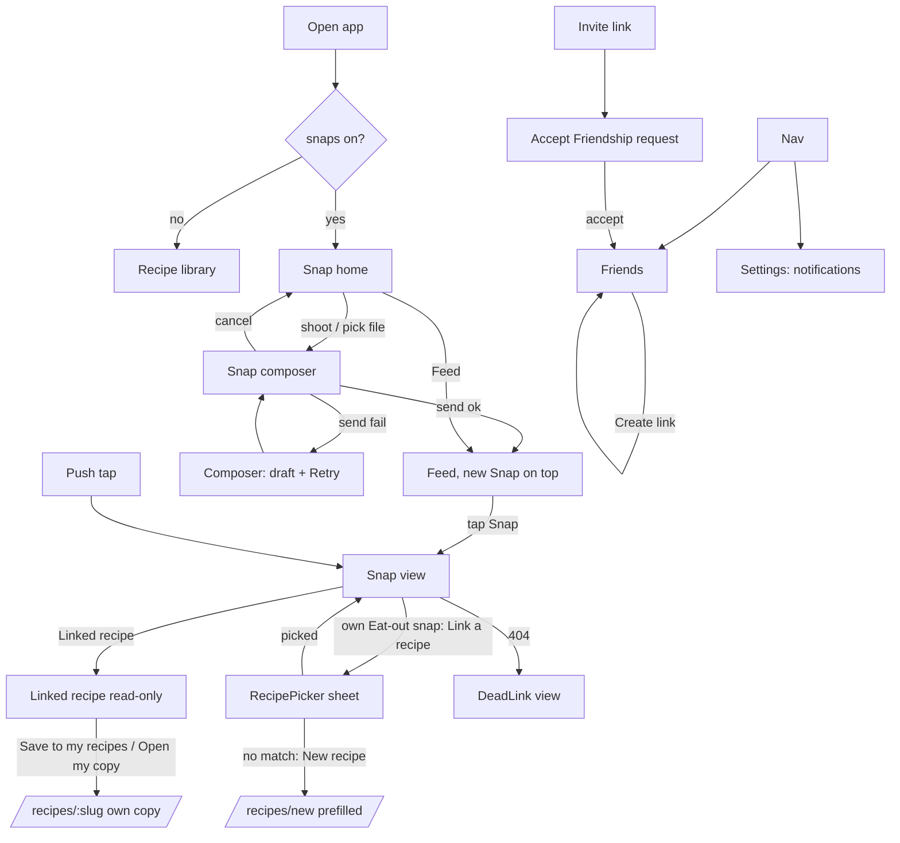

# Snap loop: UI

Inputs: [brief](00-brief.md), [requirements](02-requirements.md), [API](04-api.md),
[ADR 0001](adr/0001-replace-households-with-user-ownership-and-friendships.md),
[ADR 0002](adr/0002-scope-queries-by-user-or-accepted-friendship.md). Terms follow the brief's Glossary. No reference
screenshots in `refs/`. Components come from `apps/web/src/ui/index.ts` unless marked new.

## Screens
| Screen | Route / entry point | Use cases | New / changed | Main components (existing names) |
|---|---|---|---|---|
| Snap home (camera) | `/` when `snaps` is on; else `/` keeps redirecting to `/recipes` (`apps/web/src/app/App.tsx:76`) | UC-1, AC-1.1-1.4 | changed (was a redirect) | `IconButton`, `Button`, `Toast`, `OfflineBanner` (`pwa/Pwa.tsx:111`); new `CameraCapture` |
| Snap composer | Sheet over Snap home after a shot or file pick | UC-1 step 3, AC-3.1 | new | `Sheet`, `Field`, `Textarea`, `Input`, `Button`; new `RecipePicker` |
| Feed | `/feed`, and swipe or "Feed" button from Snap home | AC-4.1, AC-4.2 | new | `Skeleton`, `EmptyState`, `DropdownMenu`; new `SnapCard`, `ReactionBar` |
| Snap view | `/snaps/:id` (Feed tap, push tap per [API Events](04-api.md#events-and-async)) | UC-2 1a, UC-3, UC-5 step 4 | new | `SnapCard`, `ReactionBar`, `Button`, `DeadLink` (`features/share/PublicRecipeView.tsx:28`) |
| Linked recipe (read-only) | `/snaps/:id/recipe` | UC-2, AC-2.1-2.2 | new route, reused view | `PublicRecipeView` with `actions` (`PublicRecipeView.tsx:33`), `RecipeSkeleton` (`:18`), `DeadLink` |
| Friends | `/friends` (nav item, flag `friends`) | UC-4, AC-6.1-6.3 | new (replaces `HouseholdSection`, `features/households/HouseholdSection.tsx:191`) | `Card`, `Button`, `Dialog`, `EmptyState`, `Skeleton`, `Toast` |
| Accept Friendship request | `/friends/invite/:token` (TBD: path, see open questions) | UC-4 step 2 | changed (from `AcceptInvitePage`, `App.tsx:163-170`) | `Card`, `Button`, `DeadLink` |
| Settings: notifications | `/settings` section (`features/households/SettingsPage.tsx:24`), flag `push` | UC-5, AC-4.3, AC-4.6 | changed | `Switch`, `Card`, `Button` |
| Admin: Friend cap | `/admin` settings form | AC-6.2 | changed | `Field`, `Input`, `Button` |
| Recipe library, editor, cook mode, plan, shopping | unchanged routes | AC-5.1 | unchanged UI, data scoped by user | as today |

New components and why:
- `CameraCapture`: no camera code exists (`01-research.md:27`); wraps `getUserMedia` with the upload fallback chosen in research (`01-research.md:40`). Uses `resizeImage` / `buildImageForm` (`features/recipes/upload.ts:106,161`) for the upload.
- `SnapCard`: full-screen photo with caption, author and dish overlay. Nothing in `ui/` is full-bleed; `Card` is a padded panel.
- `ReactionBar`: fixed set of about 6 emoji ([API decisions](04-api.md#decisions-owner-2026-11-12)), toggle buttons, no counts.
- `RecipePicker`: search over own recipes (`GET /recipes?q=`) inside a `Sheet`; used by the composer and by UC-3.

Nav: `NAV_ITEMS` (`apps/web/src/app/nav.ts:13-19`) gains "Snap" (`/`, flag `snaps`) first and "Friends" (flag `friends`); "Recipes" stays. On phones Friends lives under More. TBD: does "Feed" get its own nav item or only the Snap home button?

## Navigation


## Wireframes

Superseded on 14 Nov 2026 by the approved mockups (https://claude.ai/artifact/SQ5ReRrPFVoSC1YrDLaSCt): a
full-screen dark camera with three controls, a menu sheet for the rest of the app, a Photos-style square grid for the
Feed, and a camera-size viewer. The decisions are in [features/snaps.md](../features/snaps.md#ui). The sketch below is
the first version, kept for history.
```
Snap home (360 px)            Snap composer (Sheet)          Feed / Snap view
+------------------------+    +------------------------+    +------------------------+
| [Feed]   Meally  [Me]  |    | [x]   New Snap         |    | Ana . 2 h ago   [...]  |
|                        |    | +--------------------+ |    |                        |
|     live camera        |    | |   photo preview    | |    |   full-bleed photo     |
|     (or "Camera off:   |    | +--------------------+ |    |                        |
|      [Choose photo]")  |    | Caption ____________   |    | "Sunday ramen"         |
|                        |    | ( ) Cooked  ( ) Eaten out   | [Recipe: Tonkotsu >]   |
|                        |    | Recipe [Pick recipe >] |    |  or  Dish: Pho . Cafe X|
| [Upload]  (O)  [Flip]  |    | Dish ___  Place ___    |    | [:) ][<3][..] (no count)|
+------------------------+    | [        Send        ] |    | swipe / [Up] [Down]    |
                              +------------------------+    +------------------------+
Linked recipe                 Friends                         Accept request
+------------------------+    +------------------------+    +------------------------+
| < Back  From Ana       |    | Friends  3 of 20       |    | Ana wants to be        |
| [Save to my recipes]   |    | [Create invite link]   |    | friends on Meally.     |
|  (or [Open my copy])   |    | Open links: 1  [Revoke]|    | [Accept]   [Not now]   |
| PublicRecipeView body  |    | Ana     since Nov  [x]|    +------------------------+
+------------------------+    +------------------------+
```
Send is tap 3 after the camera opens: shutter (1), optional caption field (2), Send (3) (NFR-1). Caption and recipe are optional, so shutter then Send is 2 taps. The "Cooked / Eaten out" toggle only shows or hides the Recipe and Dish fields. The client sends `recipeId` or `dishName`, and the API has no type field.

## States
| Screen | Empty | Loading | Error | Partial | Success | No permission |
|---|---|---|---|---|---|---|
| Snap home | n/a | camera starting: dark frame plus spinner on the shutter | camera denied or missing: "Camera is off" with "Choose photo" (AC-1.3) | offline: `OfflineBanner`, shutter still works and Send keeps a draft | live preview | flag off: redirect to `/recipes` |
| Snap composer | n/a | Send shows `Button loading` | 413 / 415: inline field error, no Snap (UC-1 4b); 5xx or network: draft kept, "Retry" (AC-1.4); 404 recipe: "Pick another recipe" | draft waiting to retry | toast "Sent", go to Feed top | n/a |
| Feed | `EmptyState` "No Snaps yet": "Take a Snap" and "Add friends" | 3 full-screen `Skeleton`s | error card plus "Try again" | next page fails: inline retry at the end; an image fails: dish or caption text over a token-coloured block | newest first | `feature_disabled` 404: redirect to `/recipes` |
| Snap view | n/a | `Skeleton` | 404 (non-friend, pending Friendship, deleted): `DeadLink` | Eat-out snap: dish and place, no recipe (UC-2 1a) | Snap plus actions | author-only actions (Link, Delete) hidden for others |
| Linked recipe | n/a | `RecipeSkeleton` | 404: `DeadLink`; save fails: toast with retry | recipe without image: no hero | `savedSlug` set: "Open my copy" (UC-2 3a) | own Snap: no save button (`own_recipe`) |
| RecipePicker | no match: "No recipe called '<dish>'" and "New recipe" prefilled (AC-3.3) | list `Skeleton` | error plus retry | n/a | results list | n/a |
| Friends | "No friends yet" and "Create invite link" | `Skeleton` rows | error plus retry; `friend_cap` 409: "You can have at most N friends" | n/a | list showing "N of cap" | flag off: route and nav hidden |
| Accept request | n/a | `Skeleton` | same 404 for unknown, used or expired (`DeadLink`); `friend_cap`, `own_invite`, `already_friends` (opens Friends), 429 "Try again later" | signed out: sign in or sign up, then return to the link (TBD, see open questions) | toast "You're now friends", go to Feed | n/a |
| Settings: notifications | n/a | switch disabled while subscribing | browser denied: "Blocked in browser settings", no re-prompt (UC-5 1a) | iOS not installed: install steps instead of the switch (AC-4.6) | switch on | `push_unconfigured` 503 or no Web Push support: section hidden |
| Admin: Friend cap | n/a | form `Skeleton` | 400: inline | n/a | toast "Saved" | non-admin: existing admin guard |

## Interactions
| Screen | User action | API operation | Optimistic update? | On error |
|---|---|---|---|---|
| Composer | Send | `POST /snaps` with a new `clientId`, reused on retry | no; Snap shown only after 201 or 200 | keep the draft, Retry re-sends the same `clientId`; 413 / 415 inline |
| Composer, Snap view | Pick recipe | `GET /recipes?q=` | n/a | retry in sheet |
| Snap view (author) | Link a recipe | `PATCH /snaps/:id` `{ recipeId }` | no | 404: toast, refetch |
| Snap view (author) | Delete | `DELETE /snaps/:id` behind a confirm `Dialog` | remove from Feed cache, roll back on error | toast; 404 counts as done (API open question) |
| Feed | Scroll | `GET /snaps?cursor=` | n/a | inline retry |
| Feed, Snap view | Show photo | `GET /snaps/:id/image/:size` (path may change, API open question) | n/a | text fallback |
| Feed, Snap view | Toggle Reaction | `PUT` / `DELETE /snaps/:id/reactions/:emoji` | yes, toggle `myReactions` | revert and toast |
| Snap view | Open Linked recipe | `GET /snaps/:id/recipe` | n/a | `DeadLink` |
| Linked recipe | Save to my recipes | `POST /snaps/:id/recipe/save` | no | 201 / 200: go to `/recipes/:slug`; `own_recipe`: open own recipe; other: toast |
| Friends | Create invite link | `POST /friends/invites`, then copy or `navigator.share` | no | `friend_cap` message |
| Friends | Revoke link | `DELETE /friends/invites/:id` | yes | revert and toast |
| Friends | Remove Friend | `DELETE /friends/:userId` after a confirm `Dialog` | yes | revert and toast |
| Friends | Load | `GET /friends`, `GET /friends/invites` | n/a | retry |
| Accept request | Open link | `GET /friends/invites/:token` | n/a | `DeadLink` |
| Accept request | Accept | `POST /friends/invites/:token/accept` | no | codes as in States; "Not now" calls nothing |
| Settings | Turn on notifications | `GET /push/key`, browser permission (user gesture only, AC-4.3), `POST /push/subscriptions` | no | denied or 503 as in States |
| Settings | Turn off | `DELETE /push/subscriptions/:id` | yes | revert |
| Admin | Save Friend cap | `PUT /admin/settings` `{ friendCap }` | no | inline |

## Accessibility and responsiveness
- Keyboard path for UC-1: Tab to the shutter (a `button` labelled "Take photo"), Enter, then focus moves into the composer `Sheet` on Caption, Tab to Send. "Choose photo" is a labelled file `input`, so keyboard and screen-reader users don't need the camera. The `Sheet` is a Radix dialog (`ui/Overlays.tsx:109`), so focus is trapped and Escape cancels.
- Feed: each `SnapCard` is an `article` with a heading made from the author and time. Up and Down arrow keys or the "Next" / "Previous" buttons move between Snaps; swipe is never the only way. The photo `alt` is the caption, else the dish name, else "Snap by <name>".
- `ReactionBar`: `button` with `aria-pressed` and a label for each emoji ("React with heart"). No counts are announced.
- Push: permission is asked only from the Settings switch; status changes use the existing `Toast` live region.
- Contrast: text over photos sits on a token-based scrim (`ui/theme.css` variables), AA minimum (NFR-5). Focus rings use the existing visible-focus styles.
- Touch targets are at least 44 px (`ui/targets.test.tsx` covers this). Widths from 360 to 1440 px: the camera and Feed are full-bleed on phones; at 1024 px and up they sit in a centred column next to the desktop sidebar. TBD: column width on desktop.
- Respect `prefers-reduced-motion`: no swipe animation, Snaps change at once.

## Look and feel
Camera-first and calm, like Locket ([brief](00-brief.md)): the photo fills the screen, with few controls drawn over it. Copy is short and in sentence case ("Send", "Save to my recipes", "Take a Snap"). No counts, badges or streaks (brief non-goals). The rest of the app keeps its current density and tokens. `refs/` is empty, so visual polish is left to the implementation PRs.

## Decisions (owner, 2026-11-12)
- **Draft store: IndexedDB until sent.** A failed Snap survives a reload or a closed tab and keeps its `clientId`, so
  a retry never creates a second Snap. It is deleted once the server confirms the send.
- **Invite path: `/invite/:token`.** The token works as a sign-up permit, even in invite-only mode. A signed-out or
  new user signs in or signs up and then lands on Accept. Without the `friends` flag the path shows DeadLink.
- **Feed entry: from Snap home only.** The Feed is one tap or swipe from the camera, and it has no nav item.
- **Defaults the owner accepted:** on desktop, Snap home and the Feed sit in a centred column at phone width. The
  Activity page (`/activity`) and its nav entry are removed. `GET /friends` returns `cap`, so the Friends screen can
  show "N of cap".

## Open questions
Approved as is. The critic's verdict was APPROVE WITH CHANGES. Build slices must apply:
- Existing screens the API changes affect: Admin (drop the household column, `counts.households`, the `households`
  flag group and the sign-up copy), Webhooks (gated on user ownership, not `householdRole`), and Share receive (use the
  `own_recipe` copy instead of `sameHousehold`).
- The client never builds image paths. It renders `imageUrl`/`thumbUrl` from the payloads (04-api open question).
- Author-only list of Reactions on the Snap view (name and emoji, no counts), with an empty state.
- After Accept, send the user to the Friends screen, and make the flowchart and the States table agree. A 200 on a
  retried accept counts as success.
- Stop the `getUserMedia` stream on shutter, on route leave and when the page is hidden.
- Push turn-off calls `PushSubscription.unsubscribe()` and then `DELETE` with the stored id.
- Set `maxLength` on inputs (caption 2000, dish name and place 120) and show `400 invalid_body` as an inline error.
- RecipePicker: prefill the search with `dishName`. After creating a recipe from the picker, return and link it.
- The doc is over its size limit (about 1,750 words). Trim it in the next edit.
