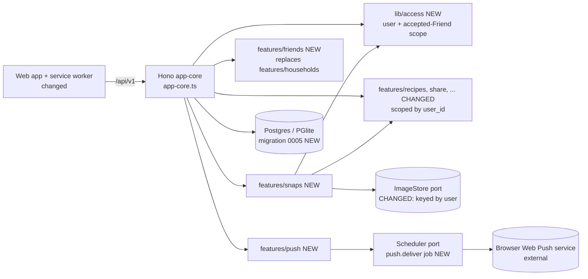
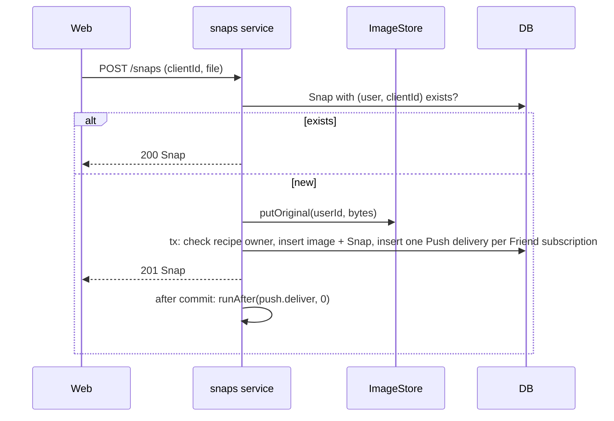
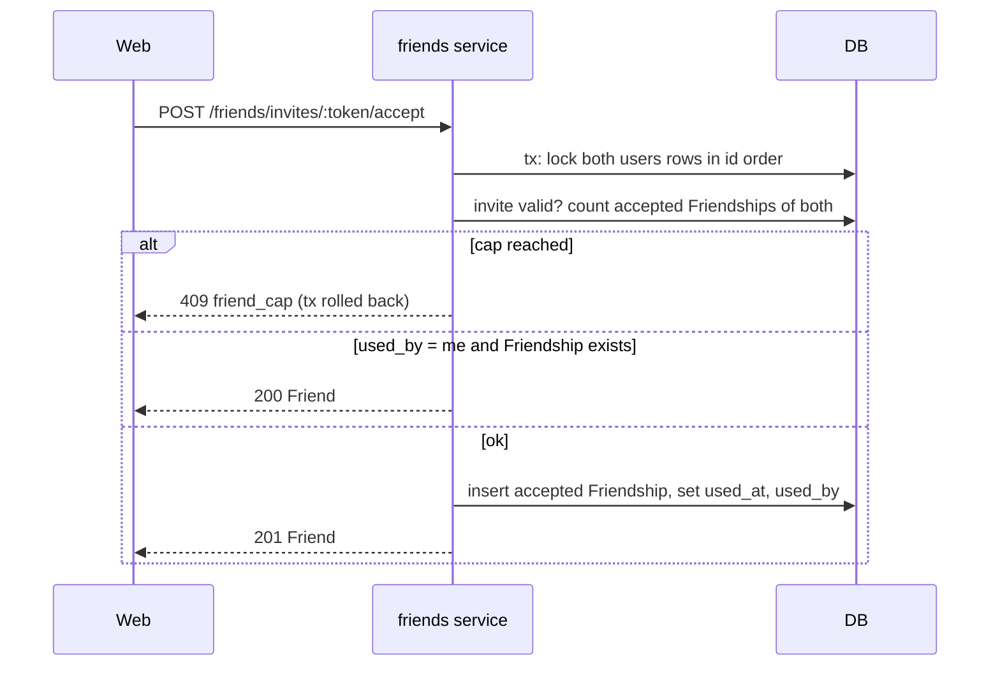

# Snap loop: backend

Inputs: [brief](00-brief.md), [requirements](02-requirements.md), [data model](03-data-model.md), [API](04-api.md),
[UI](05-ui.md), ADRs [0001](adr/0001-replace-households-with-user-ownership-and-friendships.md),
[0002](adr/0002-scope-queries-by-user-or-accepted-friendship.md),
[0003](adr/0003-migrate-single-member-households-by-rekeying.md). Terms follow the brief's Glossary.

## Components

The server keeps its ports and adapters layout (`apps/server/src/ports/index.ts:27-101`): features call `Db`,
`ImageStore` and `Scheduler`, never the Node APIs directly.

## Key sequences


```mermaid
sequenceDiagram
  participant J as push.deliver job
  participant D as DB
  participant P as Web Push service
  J->>D: claim due Push deliveries (lease)
  J->>P: encrypted POST, VAPID-signed, timeout
  alt 2xx
    J->>D: delete delivery
  else 404 / 410
    J->>D: delete Push subscription (cascades deliveries)
  else 429 / 5xx / timeout
    J->>D: attempts+1, next_attempt_at = backoff; give up after max attempts
  end
```



Failure path, upload: when the DB transaction fails after `putOriginal`, the service calls `ImageStore.delete` and
returns 500; the web app keeps the draft and retries with the same `clientId` (AC-1.4).

## Modules and types
| Module | Responsibility | Main types / interfaces | Depends on |
|---|---|---|---|
| `lib/access` (new) | The one place for the ADR 0002 rule: `ownedBy(session)`, `readableSnap(session, snapId)` joining `friendships` on `status = accepted` | `Viewer { userId }` | `Db` |
| `features/snaps` (new) | Snap CRUD, Feed keyset query, Reactions, snap image and Linked recipe read, save | `SnapService`, `Snap`, `Reaction` (shared zod) | `lib/access`, `ImageStore`, `features/share/save.ts` copy logic, `features/push` enqueue |
| `features/friends` (new) | Friendship requests (invite links), accept, list, remove, Friend cap | `FriendsService`, `Friend` | `Db`, instance settings, existing invite limiter (`features/households/routes.ts:65-66`) |
| `features/push` (new) | VAPID key, Push subscriptions, enqueue, `push.deliver` job | `PushService`, `PushSender` port | `Scheduler`, `Db`, a Web Push library (TBD, see open questions) |
| `features/households` | Removed; invite token code moves to `friends` | | |
| `features/timeline` | `GET /timeline` removed (API decisions) | | |
| Every household-scoped feature | `householdId` filters become `userId` | | `lib/access` |
| `ports/ImageStore` | Key changes from `householdId` to the owning user id (`ports/index.ts:31-37`) | `ImageStore` | node and supabase adapters |
| `db/migrations/0005_*` (hand-written) | ADR 0003 rekey and contract in one SQL file | | |

## Concurrency model
- Execution: sync requests for every route; `push.deliver` is a background job on the existing `Scheduler`
  (`ports/index.ts:56-71`), started by `runAfter` after commit and swept by `every` for retries. The Migration runs
  in `migrate()` at startup, before the server listens (`db/index.ts:33,41`).
- Shared state and contention points: a user's Friend count (two accepts at once); one invite token (two redeemers);
  `(user, clientId)` (a retry racing the first send); a Reaction key (double tap); a Push delivery row (two job
  runs); a Push subscription endpoint (re-subscribe from another account).
- Consistency per operation: strong for every write and for Friend access (each read joins `friendships`, so a
  removal takes effect on the next request, AC-6.3). Push is eventual: the Feed already shows the Snap while the push
  is in flight.
- Control: Friend accept locks both `users` rows in id order (`SELECT … FOR UPDATE`) and counts inside the same
  transaction, default READ COMMITTED; the invite is marked used in that transaction with `used_at IS NULL` in the
  `WHERE`. Snap send relies on the unique `(user_id, client_id)`; on a unique violation the service re-reads and
  returns 200. Reactions use `INSERT … ON CONFLICT DO NOTHING` and enqueue a push only when a row was inserted.
  Push deliveries are claimed with a lease, as `webhook_retries` (`webhooks/service.ts:168-170`).
- Idempotency and dedupe: `clientId` per user, no window (kept with the Snap); save by origin
  (`share/save.ts:26-31`); accept returns 200 when `used_by` is the session user; subscribe upserts on `endpoint`.
  `push.deliver` may send a push twice after a crash inside the lease; the service worker tags notifications by
  `snapId` so a duplicate replaces the first.
- Ordering: Feed by `(created_at desc, id desc)`. Push has no ordering key (API Events).
- Retries and timeouts: Web Push send: timeout TBD (the repo's outbound fetch uses 10 s, `import-url/fetch.ts:6`);
  retry 3 times with full-jitter backoff, base 60 s, cap 30 min (`webhooks/service.ts:16-22`, API decisions).
  Upload: body limit `MAX_IMAGE_BYTES` + 512 KB (`timeline/routes.ts:53-58`).
- Backpressure and limits: job claims a batch of 20 per run, as webhook retries (`webhooks/service.ts:171`);
  Friends per user ≤ Friend cap; no Snap upload rate limit in v1 (API decisions).
- Load model: one Snap fans out to at most 20 Friends × their subscriptions (Friend cap, NFR-2); payload ≤ 2 KB
  (NFR-3); upload ≤ 10 MB. What breaks first is image processing with sharp on the Node runtime under bursts of
  uploads. TBD: expected Snaps per user per day (data model TBD) to size this.

## Infrastructure
- No new runtime, queue or cache: the push queue is a table plus the existing `Scheduler`.
- New config: VAPID public and private keys and a contact subject, as env vars. TBD: generate on first start and
  store in `instance_settings`, or require env vars? Without keys, `/push/key` returns `503 push_unconfigured`.
- New dependency: a Web Push library for payload encryption and VAPID signing (TBD, open questions).
- Edge runtime: `openPostgres` applies no migrations (`db/postgres.ts:17`); edge deploys run `drizzle-kit migrate`
  out of band, so the same 0005 file applies there. Push delivery on edge runs through the cron route
  (`ports/index.ts:66`).
- Cost: outbound push requests only; Web Push services are free for senders.

## Failure modes
| Failure | Detection | Impact | Mitigation |
|---|---|---|---|
| Web Push service slow | send timeout | push late | timeout, retry with backoff, lease frees the row |
| Web Push service down / 5xx / 429 | status code | push late or dropped after max attempts | 3 retries, then delete the delivery and log |
| Subscription gone (404/410) | status code | none | delete the Push subscription (AC-4.5) |
| VAPID keys missing | startup check | no push | `503 push_unconfigured`, UI hides push |
| DB slow or down | request error, `ready` rejects | all writes fail | 500; web app keeps the draft (AC-1.4) |
| Image store full or failing | `putOriginal` throws | Snap not sent | 500, draft kept; orphan file removed on tx failure |
| Migration finds a multi-member Household | SQL guard raises | server won't start | abort with the ADR 0003 message, data unchanged |
| Migration fails mid-way | `migrate()` rejects | server won't start | single SQL transaction rolls back; restore from backup |
| Image files not yet moved after rekey | image `get` returns null | broken images | repeatable startup step moves files (open questions) |
| Two accepts past the cap | | cap exceeded | row locks in id order |
| Push job crash mid-batch | lease expiry | duplicate push | notification tag by `snapId` |

## Observability
| Signal (log, metric, trace, alert) | Proves which NFR or failure | Threshold |
|---|---|---|
| Log per push send: status, duration, attempts | NFR-7 delivery latency, AC-4.5 | TBD: NFR-7 target (lead proposed p95 < 60 s) |
| Log on push give-up and on 404/410 delete | Web Push down, subscription gone | TBD: alert rate |
| Log per payload size, reject > 2 KB | NFR-3 | 2 KB |
| Migration log: per-table row counts before and after, abort reason | NFR-4, ADR 0003 | counts equal, else abort |
| 404 count on friend read paths (existing request log) | NFR-6 abuse probing | TBD |
| Admin info: drop `counts.households` | compatibility | |

The repo has no metrics stack; signals are structured logs. TBD: is a metrics endpoint wanted?

## Security and privacy
- Spoofing: every route sits behind `requireAuth`; API tokens keep their user (`tokens.ts:24`).
- Tampering / disclosure across users: all reads go through `lib/access`; friend reads re-check that the Linked
  recipe's owner is the Snap's author, and snap image routes check the image belongs to the Snap or its current Linked
  recipe (API open questions). Two 404 tests per friend-readable path (ADR 0002).
- Invite links: sha256 token hash, one use, the same 404 for unknown, used and expired; existing rate limiter.
- Push: payload holds only `type`, `snapId`, sender name, emoji (no caption or photo), encrypted end-to-end by Web
  Push; endpoints and keys are personal data, deleted on gone or turn-off; VAPID private key never leaves the server.
- Abuse: Friend cap bounds fan-out; Reaction keys validated against the fixed set; no push when the reactor is the
  author.
- Data handling: caption, dish name, place and photos are Friends-only personal data (data model Retention).
  TBD: are Snaps and Friendships in the backup export?

## Testing strategy
- Unit: Feed cursor, backoff (reuse `retryDelayMs`), payload size guard, cap check, reaction-key validation.
- Integration (`openTestDb()`, PGlite and `DATABASE_URL`): each AC group of US-1 to US-6; two 404 tests per friend
  path (non-friend, pending) and an other-user 404 per re-keyed table (NFR-6, CLAUDE.md); concurrent accepts at the
  cap; duplicate `clientId`; duplicate Reaction sends one push.
- Push: a fake `PushSender` returning 201, 410, 500 and timeout, to prove AC-4.4 and AC-4.5.
- Migration: fixtures with single-member Households (counts equal, NFR-4), a multi-member Household (abort, data
  unchanged), and a null `created_by` recipe.
- E2E (Playwright): send a Snap via file upload, Friend sees it, opens and saves the recipe; NFR-1 tap count; NFR-5
  widths 360-1440 px.
- Load: none planned; TBD if the Snap volume answer calls for one.

## Rollout and rollback
1. Additive PRs behind `snaps`, `friends`, `push` (off by default), shipped while households still exist. TBD:
   can friends work before the rekey, or does each roadmap row land after 0005?
2. Release with migration 0005: release notes require a fresh backup (`features/backups`) and warn that API-token
   scripts on `/household/*` and `/timeline` break. Deploy order: stop the old server, start the new one, which
   migrates before listening. Old code can't run on the new schema, so there is no mixed-version window.
3. Turn on `friends`, then `snaps`, then `push`. Halt signals: push give-up rate, 5xx on `/snaps`.
- Kill switch: each flag; `push` off stops enqueueing, and the job drains nothing new.
- Rollback: flags off for features; for 0005, stop the server, restore the pre-upgrade backup, run the previous
  release (ADR 0001: not reversible in place).

## Glossary proposals
| Term | Meaning |
|---|---|
| Push delivery | One queued push send with retry state (`push_deliveries`) |
| Migration | The one-off ADR 0003 rekey in `0005` |

## Decisions (owner, 2026-11-12)
- **Image keys: a startup move step that is safe to repeat.** The rekey migration leaves a household → user map. A
  startup step copies each household's images to the user key (local files on Node, a Supabase Storage object copy on
  edge, run from the cron jobs route), deletes the originals only once the copy is verified, then drops the map.
- **VAPID keys are generated on first start** and stored in `instance_settings`. Env vars override them.
- **Edge (Supabase) gets full support, push included.** Push encryption and VAPID signing are built on WebCrypto, so
  the same code runs on Node and Deno (no `node:crypto` ECDH). On edge, `push.deliver` runs from the cron jobs route,
  so delivery takes about a minute or more. Snap images on edge are processed on the device, following the
  existing recipe-image pattern (`163251c`). Measure batch size against the edge CPU limit (200 ms–2 s per request,
  `docs/design/2026-11-11-supabase/design.md` §2.1).
- **Defaults the owner accepted:** the rekey PR lands first and every additive row stacks on it; refer to it by role,
  not by migration number. The push send timeout is 10 s (`TIMEOUT_MS`, `import-url/fetch.ts:6`). NFR-7 has no target
  in v1.

## Open questions
Approved as is, over a REVISE verdict from the critic. Build slices must apply:
- **Blocking, required in the push PR: SSRF.** Subscribe-time checks: `https` only, and `assertWebhookUrl`-style
  checks against private and blocked IPs. Sends go out through the existing `Fetcher` (`kind: post`, no redirects), and
  the library is used only for encryption and headers. Add a 400 test for private and http endpoints.
- Accept order: lock, then load the invite. If `used_by` is the session user and the Friendship exists, return 200.
  Otherwise check used or expired (404), own invite, already friends, then the cap, then insert.
- Also check the cap on `POST /friends/invites` (409 `friend_cap`).
- New PKs in the rekey file: `food_aisles` → `(user_id, food)`, and `household_feed_tokens` → keyed by `user_id`. List
  every unique index that contains `household_id`.
- Rollback with `DATABASE_URL`: in-app backups are off there (`apps/server/src/index.ts:20-22`), so require `pg_dump`
  plus a copy of the images. The image move copies before it deletes.
- Reactions: notify once per (Snap, user, emoji), even after DELETE then PUT. Keep a marker that DELETE doesn't clear.
- Recheck a push delivery when it is claimed: drop it if the Friendship is gone, the Snap is deleted, or the
  subscription changed owner.
- On a `clientId` race, the losing request deletes its own uploaded image before it returns 200.
- Logging: no request logger exists. Add a small structured `log()` in `lib` for the migration counts and push
  outcomes.
- Use the job name `push.deliver` in both docs. Add a risk row for slow image processing, with a concurrency limit as
  the mitigation.
