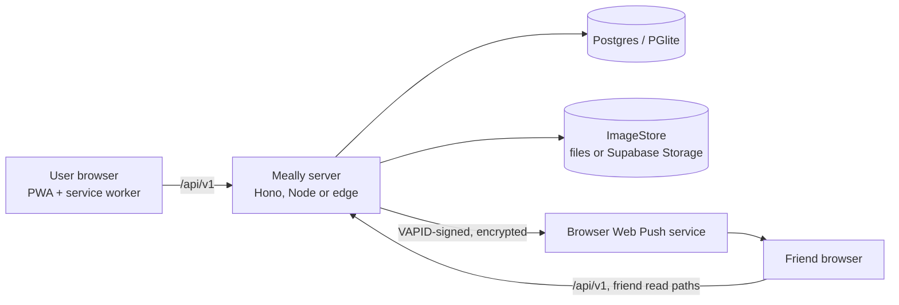

# Snap loop: design   (draft · 2026-11-12 · feature-design workflow, owner review)

Tracking issue: [#75](https://github.com/bachtly/Meally/issues/75). Terms follow the [brief's Glossary](00-brief.md#glossary).

## Context and scope
Meally is a recipe manager whose home screen is the recipe library (`apps/web/src/app/App.tsx:76-77`), and whose data
belongs to a Household (`apps/server/src/db/schema/auth.ts:15-19`). The owner wants a Locket-style loop instead: take a
Snap, send it to Friends, and let a Friend open the Linked recipe behind it ([brief](00-brief.md#problem)). That Snaps
drive retention is an assumption with no Meally usage data behind it.

Scope: Snaps, Feed, Reactions, Friendships with a Friend cap, opt-in web push, and retiring Households in favour of user
ownership. Recipe tools stay, scoped to the user.

## Goals and non-goals
Goals G1-G6 and the non-goals are in the [brief](00-brief.md#goals). In short: snap in at most 3 taps after the camera
opens (G1), open and save a Friend's Linked recipe (G2), Eat-out snaps with dish name and place (G3), Feed plus opt-in
push (G4), recipe tools still work (G5), Households replaced with no recipe lost (G6). Not in scope: native apps,
public profiles or discovery, counts, AI recognition, Rollcall, streaks, paid tiers, shared editing between Friends
([#76](https://github.com/bachtly/Meally/issues/76)), block and report, video.

## Overview

The home screen becomes a camera. A Snap is stored through the existing Image pipeline and shown in the Feed of its
author and their accepted Friends. Friends read only Snaps and their Linked recipes; every other query is scoped to the
session user ([ADR 0002](adr/0002-scope-queries-by-user-or-accepted-friendship.md)). A one-off SQL migration rekeys
every `household_id` to the household's single user and drops Households
([ADR 0003](adr/0003-migrate-single-member-households-by-rekeying.md)). Push uses a table-backed queue on the existing
`Scheduler`; no new service is added.

## Design
### Requirements → [02-requirements.md](02-requirements.md)
Six use cases (UC-1 to UC-6) and six user stories with 24 ACs. Actors: User, Friend, Non-friend, Instance admin, and
the one-off migration. NFRs with sources: at most 3 taps (NFR-1), Friend cap default 20 (NFR-2), push payload at most
2 KB (NFR-3), no recipe lost (NFR-4), AA and 44 px targets (NFR-5), non-friend 404 on every friend read path (NFR-6).
Snaps are kept until the author deletes them (NFR-8); the image limit is the existing 10 MB (NFR-9). NFR-7 has no
target in v1 ([backend decisions](06-backend.md#decisions-owner-2026-11-12)). The place is typed text only (AC-3.4).
AC-6.4's "copy to each member and auto-friend" wording is superseded by ADR 0003 (rekey, abort on multi-member).

### Data model → [03-data-model.md](03-data-model.md)
New tables: `snaps`, `reactions`, `friendships` (ordered pair, `pending`/`accepted`), `friendship_invites`,
`push_subscriptions`, `push_deliveries`. The 21 household-scoped tables get `user_id` in place of `household_id`;
`households`, `users.household_id` and `household_role` are dropped. Key invariants: a Snap's Linked recipe and Image
are owned by its author; one Snap per `(user_id, client_id)`; one Reaction per user, Snap and emoji. The Friend cap is
an `instance_settings` key with a code fallback of 20. The ADR 0003 decision replaces the data model's copy plan.

### API → [04-api.md](04-api.md)
New groups under `/api/v1`: `/snaps` (send with `clientId` dedupe, keyset Feed, view, link recipe, delete, image,
Linked recipe read and save, Reactions), `/friends` (invite links, accept, list, remove) and `/push` (key,
subscriptions), behind the `snaps`, `friends` and `push` flags. Breaking: `/household/*` and `GET /timeline` are
removed; household-scoped routes keep their shapes but return the user's rows. Image URLs are built by the server
(`/snaps/:id/images/:imageId/:size`) so immutable caching stays correct after a relink
([API open questions](04-api.md#open-questions)). A flag that is off returns `404 feature_disabled`.

### UI → [05-ui.md](05-ui.md)
`/` becomes Snap home (camera with file-upload fallback) when `snaps` is on; a composer `Sheet` sends in at most 3
taps. The Feed is full screen, reached from Snap home only, with keyboard and button navigation. Snap view, the Linked
recipe (reusing `PublicRecipeView`), Friends, the Accept page at `/invite/:token`, a notifications switch in Settings
and the Friend cap in Admin. Failed sends stay as drafts in IndexedDB with their `clientId`. New components:
`CameraCapture`, `SnapCard`, `ReactionBar`, `RecipePicker`. The household UI and `/activity` are removed.

### Backend → [06-backend.md](06-backend.md)
New modules `features/snaps`, `features/friends` (replaces `features/households`), `features/push` and `lib/access`,
which holds the ADR 0002 rule in one place. Friend accept locks both `users` rows in id order and checks the cap in
the same transaction. `push.deliver` claims Push deliveries with a lease, retries 3 times with backoff (webhook
values), and deletes gone subscriptions. Push crypto is built on WebCrypto, so Node and edge share it. VAPID keys are
generated on first start. Image files move to user keys in a repeatable startup step after the rekey.

## Alternatives considered
- **O2, keep Households and add Snaps and Friendships on top:** additive, reversible, medium cost, keeps shared
  editing. Rejected because it contradicts G6 and the owner's choice ([ADR 0001](adr/0001-replace-households-with-user-ownership-and-friendships.md)).
- **O3, a hidden household of one per user:** lower cost and reversible. Rejected by the owner because it keeps
  households as a hidden concept ([research open questions](01-research.md#open-questions)).
- **O0, reuse Timeline events and Share links:** no new tables, but no Friend graph, no Feed and no Eat-out snap
  (`timeline_events.recipe_id` is NOT NULL). Fails G2-G4 and G6 ([research](01-research.md#o0--reuse-timeline-events-and-share-links)).
- **Copy Household data to every member:** rejected for a single-file SQL rekey that aborts on multi-member Households
  ([ADR 0003](adr/0003-migrate-single-member-households-by-rekeying.md)).
- **Friendship grants read on all data:** rejected for the small, listed friend read surface ([ADR 0002](adr/0002-scope-queries-by-user-or-accepted-friendship.md)).

## Cross-cutting concerns
- **Security:** every route sits behind `requireAuth` and its flag. Friend reads go through `lib/access`, re-check the
  Linked recipe's owner, and have two 404 tests each (non-friend, pending Friendship). Invite tokens are hashed,
  single-use and rate-limited, and unknown, used and expired tokens give the same 404. Push endpoints are checked
  against SSRF at subscribe time (https only, no private IPs) and sent through the existing `Fetcher`
  ([backend open questions](06-backend.md#open-questions)).
- **Privacy:** caption, dish name, place and photos are Friends-only personal data. Push payloads carry only type,
  `snapId`, sender name and emoji. Endpoints are deleted when gone or turned off. Export of Snaps and Friendships:
  TBD (open question).
- **Observability:** no metrics stack exists. A small structured `log()` covers migration row counts, push outcomes
  and payload size.
- **Accessibility:** keyboard path for UC-1, labelled file input as the camera fallback, `aria-pressed` Reactions,
  token-based scrim for text over photos, 44 px targets, widths 360-1440 px ([UI](05-ui.md#accessibility-and-responsiveness)).
- **Cost:** no new infrastructure; outbound push requests only. Snap volume per user per day is unknown (TBD), so
  image-processing load isn't sized.

## Risks and open questions
| Risk or question | Mitigation or next step | Owner |
|---|---|---|
| Snaps don't drive retention (no usage data) | Flags let the loop be turned off; recipe tools stay | owner |
| An instance has a multi-member Household and can't upgrade | ADR 0003 abort message tells the admin to split it by hand | owner |
| Migration fails or must be undone | Single SQL transaction; fresh backup required (`pg_dump` plus images with `DATABASE_URL`) | lead (F1) |
| Images broken between rekey and file move | Repeatable startup move, copy before delete | lead (F1) |
| iOS users without Home Screen install get no push | Feed still works; Settings explains install (AC-4.6) | owner |
| Image processing slows under bursts of uploads | Concurrency limit on processing; on edge, images are resized on the device | lead (F4) |
| Push delivery on edge takes a minute or more (cron) | Accepted in v1, NFR-7 has no target | owner |
| API-token scripts on `/household/*` and `/timeline` break | Release notes | lead (F1) |
| Loss of shared editing for couples | Out of scope, tracked in [#76](https://github.com/bachtly/Meally/issues/76) | owner |
| Snap volume | Sized for 1–5 Snaps per user per day. A concurrency limit on image processing, no load test (owner, 2026-11-12) | lead (F4) |
| Backup and export scope | Include Snaps (with photos) and Friendships; exclude Push subscriptions, which belong to a device (owner, 2026-11-12) | lead (F4, F3) |
| Invite expiry and cap bound | An invite link is valid for 7 days by default. The UI shows this as text ("Valid for 7 days") with no choice to make. Admin cap input accepts at most 100 (lead default) (owner, 2026-11-12) | lead (F3) |
| Pruning | Delete push delivery rows on success or give-up (as `webhook_retries` does). A daily sweep deletes used and expired invites | lead (F8, F3) |
| Edge deploy window | Migration and function deploy are separate on edge. The release notes give the order (maintenance, migrate, deploy, image move) | lead (F1) |
| Reactions and recipe save are Friend paths | `lib/access`, plus two 404 tests on each (non-friend, removed Friendship) | lead (F5, F7) |
| Web Push crypto | Our own WebCrypto encryption and VAPID signing, so it runs on Node and Deno. Sends go through the SSRF-safe `Fetcher`. Spike it first in F8 | lead (F8) |

## Decisions
| ADR | Decision |
|---|---|
| [0001](adr/0001-replace-households-with-user-ownership-and-friendships.md) | Replace Households with user ownership and Friendships (O1) |
| [0002](adr/0002-scope-queries-by-user-or-accepted-friendship.md) | Scope every query by the user; accepted Friendship only on Snap, Feed and Linked recipe reads |
| [0003](adr/0003-migrate-single-member-households-by-rekeying.md) | Rekey single-member Households in one SQL file; abort otherwise |

Owner decisions recorded in the stage docs: invite accept creates an accepted Friendship with no pending row, a fixed
set of about 6 Reactions, `GET /timeline` removed, caption up to 2000 characters and dish name and place up to 120,
drafts in IndexedDB, invite path `/invite/:token`, VAPID keys generated on first start, full edge support.

## Glossary proposals
| Term | Meaning |
|---|---|
| Draft | A Snap kept on the device (IndexedDB) until the server confirms it, with its `clientId` |
| Push delivery | One queued push send with retry state (`push_deliveries`) |
| Friendship invite | The one-time link that carries a Friendship request (`friendship_invites`) |
| Migration | The one-off ADR 0003 rekey of Household data to users |
| Instance admin | The person who runs a self-hosted instance and sets the Friend cap |
