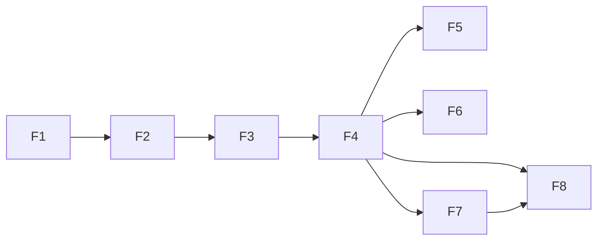

# Snap loop: roadmap

Design: [design.md](design.md). All stages ran; none were skipped ([brief](00-brief.md#stages)). One stacked PR per
slice (CLAUDE.md). Each slice adds `docs/design/features/<key>.md`.

## F1 · Rekey Households to users
- Status: ⬜
- Depends on: none
- AC ids: AC-2.4, AC-5.1, AC-6.4 (as amended by ADR 0003: rekey, abort on multi-member, no auto-friend), AC-6.5
- Design refs: [ADR 0003](adr/0003-migrate-single-member-households-by-rekeying.md),
  [03-data-model.md#decisions-owner-2026-11-12](03-data-model.md#decisions-owner-2026-11-12) (not the superseded
  migration-and-backfill copy plan), [03-data-model.md#open-questions](03-data-model.md#open-questions) (21 tables,
  new PKs for `food_aisles` and `household_feed_tokens`), [06-backend.md#open-questions](06-backend.md#open-questions),
  [06-backend.md#rollout-and-rollback](06-backend.md#rollout-and-rollback),
  [04-api.md#compatibility](04-api.md#compatibility), [ADR 0003](adr/0003-migrate-single-member-households-by-rekeying.md)
- Goal: hand-written SQL rekey with the multi-member abort, `lib/access`, user-scoped services and 404 tests, startup
  image move, household routes and UI removed, isolation rule rewritten in CLAUDE.md and `docs/design/03-architecture.md`.
- Migration file: create the rekey as a **custom migration** (`drizzle-kit generate --custom`, or a hand-written file)
  whose snapshot matches the new TS schema, as `0001_recipe_search` does. Don't run a plain `db:generate` for it: a
  generated diff drops and re-adds columns. The CLAUDE.md regenerate-after-rebase rule doesn't apply to this file. F1
  adds that exception to CLAUDE.md.
- Release: F1 removes household invites, which invite-only sign-up depends on today. F1, F2 and F3 ship in **one
  release**, so the Friendship invite link (`/invite/:token`, a sign-up permit) replaces them before users see the
  gap.
- Edge: `drizzle-kit migrate` runs separately from the function deploy. The release notes give the order: put the app
  in maintenance, migrate, deploy the function, then run the image move from the cron route.

## F2 · Shared contracts and flags
- Status: ⬜
- Depends on: F1
- AC ids: none
- Design refs: [04-api.md#contracts](04-api.md#contracts), [03-data-model.md#attributes-new-or-changed-only](03-data-model.md#attributes-new-or-changed-only)
- Goal: `snaps`, `friends`, `push` flags, zod shapes in `@meally/shared`, and the additive migration for the new tables.
  It includes the columns the later stages settled: `friendship_invites.used_by` and `expires_at` (7 days by
  default), a Reaction notification marker that DELETE doesn't clear, `push_deliveries` modelled on `webhook_retries`
  (`attempt`, `next_at`), the Feed index `(user_id, created_at desc, id)`, and `snaps.client_id` unique per user.

## F3 · Friends
- Status: ⬜
- Depends on: F2
- AC ids: AC-6.1, AC-6.2, AC-6.3
- Design refs: [04-api.md#friends](04-api.md#friends), [05-ui.md#screens](05-ui.md#screens),
  [06-backend.md#concurrency-model](06-backend.md#concurrency-model)
- Goal: invite links, `/invite/:token` accept with the Friend cap, Friends screen, remove, and the Admin Friend cap.

## F4 · Send a Snap and the Feed
- Status: ⬜
- Depends on: F3
- AC ids: AC-1.1, AC-1.2, AC-1.3, AC-1.4, AC-3.1, AC-4.1
- Design refs: [04-api.md#post-snaps](04-api.md#post-snaps), [05-ui.md#wireframes](05-ui.md#wireframes),
  [06-backend.md#key-sequences](06-backend.md#key-sequences)
- Goal: camera home with upload fallback, composer with drafts and `clientId` dedupe, keyset Feed of own and Friends' Snaps.

## F5 · Snap view and Save to my recipes
- Status: ⬜
- Depends on: F4
- AC ids: AC-2.1, AC-2.2, AC-2.3
- Design refs: [04-api.md#get-snapsidrecipe](04-api.md#get-snapsidrecipe), [05-ui.md#states](05-ui.md#states)
- Goal: Snap view, read-only Linked recipe with snap image paths, save with origin dedupe, two 404 tests per path.

## F6 · Link an Eat-out snap later
- Status: ⬜
- Depends on: F4
- AC ids: AC-3.2, AC-3.3, AC-3.4
- Design refs: [04-api.md#get-snapsid--patch-snapsid--delete-snapsid](04-api.md#get-snapsid--patch-snapsid--delete-snapsid),
  [05-ui.md#interactions](05-ui.md#interactions)
- Goal: author-only `PATCH` of `recipeId`, `RecipePicker` prefilled with the dish name, empty state with "New recipe".

## F7 · Reactions
- Status: ⬜
- Depends on: F4
- AC ids: AC-4.2
- Design refs: [04-api.md#put--delete-snapsidreactionsemoji](04-api.md#put--delete-snapsidreactionsemoji)
- Goal: fixed emoji set, no counts, author-only reaction list, one notification marker per (Snap, user, emoji).
- Access: Reaction PUT and DELETE are Friend paths and go through `lib/access`. Each one has two 404 tests: a
  non-friend, and a removed Friendship. F5 adds the same two tests to Save to my recipes.

## F8 · Web push
- Status: ⬜
- Depends on: F4, F7
- AC ids: AC-4.3, AC-4.4, AC-4.5, AC-4.6
- Design refs: [04-api.md#push](04-api.md#push), [06-backend.md#failure-modes](06-backend.md#failure-modes),
  [06-backend.md#security-and-privacy](06-backend.md#security-and-privacy)
- Goal: VAPID keys, subscriptions with SSRF checks, `push.deliver` queue with retries, service worker push handler,
  Settings switch.

| Wave | Features |
|---|---|
| 1 | F1 |
| 2 | F2 |
| 3 | F3 |
| 4 | F4 |
| 5 | F5, F6, F7 |
| 6 | F8 |
